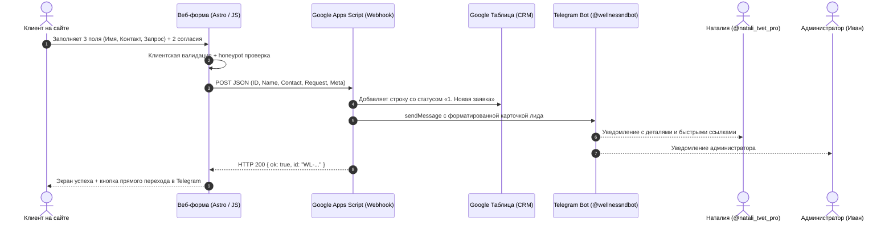

# ADR-0003: Архитектура формы заявки, Google Sheets CRM и Telegram-бота

**Статус:** Принято и развёрнуто в production (30 октября 2026 года).
**Контекст:** Реализация автономного, бесплатного и надёжного контура приёма клиентских обращений с сайта Wellness Наталии Долговой.

---

## 1. Обзор архитектуры

Контур приёма заявок работает по бессерверной модели без постоянных расходов на SaaS:



---

## 2. Компоненты системы и идентификаторы

### 2.1. Веб-форма на сайте (Frontend)
* **Размещение**: страница записи [apps/wellness/src/components/EnquiryForm.astro](file:///d:/Projects/Natali/apps/wellness/src/components/EnquiryForm.astro) на `/ru/booking/` и `/en/booking/`.
* **Принцип**: максимальное снижение барьера входа («меньше полей — выше конверсия»).
* **Поля формы**:
  1. `name` (Имя) — обязательное, строка.
  2. `contact` (Контакт для связи) — обязательное, единая строка для любого удобного канала (Telegram `@username`, WhatsApp, телефон `+7...` или Email).
  3. `request` (Кратко опишите запрос) — обязательное, многострочный текст задачи/вопроса.
  4. `adultConfirmed` (Чекбокс 18+) — подтверждение совершеннолетия.
  5. `consent` (Чекбокс ПДн) — согласие на обработку персональных данных.
  6. `website_hp` (Honeypot) — скрытое поле-ловушка для спам-ботов.
* **Логика валидации**: библиотека [packages/forms/src/index.mjs](file:///d:/Projects/Natali/packages/forms/src/index.mjs).
* **Поведение при отправке**:
  * Асинхронный fetch с блокировкой кнопки и индикатором отправки;
  * Показ красивого сообщения об успехе с уникальным номером заявки (`WL-...`);
  * Если отправка не удалась — мгновенное предложение написать Наталии лично в Telegram с сохранением введенного текста.

---

### 2.2. Google Таблица (CRM-система)
* **Название таблицы**: `CRM Заявки — Наталия Долгова`
* **ID таблицы**: `1PUybRboQFuNJldodtck2S6aYqHDTQpvkszn3DJlzXM8`
* **URL**: [https://docs.google.com/spreadsheets/d/1PUybRboQFuNJldodtck2S6aYqHDTQpvkszn3DJlzXM8/edit](https://docs.google.com/spreadsheets/d/1PUybRboQFuNJldodtck2S6aYqHDTQpvkszn3DJlzXM8/edit)
* **Владение**: создана администратором, предоставлен полный доступ (`Editor`) для `ivan.dolgov.hd@gmail.com` с последующей передачей владения аккаунту Наталии.
* **Лист**: `Заявки`
* **Структура столбцов**:
  1. **A (`ID заявки`)**: уникальный код обращения (например, `WL-1730308800000`).
  2. **B (`Дата и время`)**: московское время поступления (`DD.MM.YYYY HH:mm`).
  3. **C (`Статус`)**: выпадающий список стадий воронки (Data Validation):
     * `1. Новая заявка` (выставляется автоматически)
     * `2. В работе / Ответ отправлен`
     * `3. Время согласовано`
     * `4. Оплачено`
     * `5. Сессия проведена`
     * `6. В сопровождении`
     * `7. Архив / Завершено`
     * `8. Отказ / Отмена`
  4. **D (`Имя клиента`)**: имя из формы.
  5. **E (`Контакт для связи`)**: контакт (TG/WA/Email/Тел).
  6. **F (`Услуга / Формат`)**: первичная консультация или контекст обращения.
  7. **G (`Часовой пояс / Город`)**: часовой пояс/гео (если указано или определено).
  8. **H (`Запрос клиента`)**: текст запроса с автоматическим переносом строк (Wrap text).
  9. **I (`Заметки специалиста`)**: поле для личных пометок Наталии по ходу ведения клиента.
* **Оформление**:
  * Закреплённая строка заголовка (Frozen Header);
  * Фирменный фон заголовка в гамме Wellness (`#3D312A`);
  * Автоматическая валидация статусов по диапазону `C2:C1000`.

---

### 2.3. Google Apps Script (Webhook & Router)
* **ID скрипта**: `1oswEUV9t9UDPo6Xbv9GiJA57ZXAxHweatg_vXK89DOG_VI--kU3c_Tru`
* **Редактор кода**: [https://script.google.com/u/0/home/projects/1oswEUV9t9UDPo6Xbv9GiJA57ZXAxHweatg_vXK89DOG_VI--kU3c_Tru/edit](https://script.google.com/u/0/home/projects/1oswEUV9t9UDPo6Xbv9GiJA57ZXAxHweatg_vXK89DOG_VI--kU3c_Tru/edit)
* **Версия деплоя**: **Версия 5** (Web App, запуск от владельца, доступ `Anyone`).
* **Канонический URL вебхука**:
  ```text
  https://script.google.com/macros/s/AKfycbwQnHrqdwVYdLyzVq3NL0TLaabGDUq6QWXtLD2ADXwj4iLr7IWm8Js8vXquHfQcE1KcCA/exec
  ```
* **Исходный код в репозитории**: [packages/forms/gas_crm_script.js](file:///d:/Projects/Natali/packages/forms/gas_crm_script.js).
* **Критическая техническая особенность**:
  > [!IMPORTANT]
  > Для совместимости с Telegram Webhook функция `doPost` возвращает `HtmlService.createHtmlOutput("OK")`, а не `ContentService.createTextOutput("OK")`.
  > `ContentService` в Google Apps Script вызывает HTTP 302 Found редирект, который диспетчер вебхуков Telegram отклоняет как ошибку `Wrong response from the webhook: 302 Found`. `HtmlService` возвращает прямой HTTP 200 OK.

---

### 2.4. Telegram-бот (@wellnessndbot)
* **Имя бота**: `Наталия Долгова | Заявки`
* **Юзернейм**: `@wellnessndbot` ([https://t.me/wellnessndbot](https://t.me/wellnessndbot))
* **ID получателей уведомлений о заявках**:
  * `400839444` — Наталия Долгова
  * `5218564894` — Иван Долгов (Администратор)
* **Интерактивный автоответчик на команду `/start`**:
  * При первом открытии или перезапуске бота пользователю отправляется иллюстрированное приветствие на русском языке;
  * Клавиатура с кнопками быстрого перехода:
    * 🌐 **Открыть сайт Wellness**: `https://wellnessnd.github.io/ru/`
    * 📋 **Форматы и цены**: `https://wellnessnd.github.io/ru/for-individuals/`
    * 💬 **Написать Наталии лично**: `https://t.me/natali_tvet_pro`
    * 📢 **Канал «Компас»**: `https://t.me/natalicompass`
    * 🇬🇧 **English / 🇷🇺 Русский**: динамическое переключение языка автоответа по `callback_query`.
* **Дополнительные команды бота**:
  * `/help` — справка и список контактов;
  * `/site` — прямая ссылка на сайт практики;
  * `/science` — ссылка на академический сайт;
  * `/contact` — прямая ссылка на личный профиль Наталии (`@natali_tvet_pro`);
  * `/channel` — ссылка на авторский канал (`@natalicompass`).

---

## 3. Регламент обслуживания и внесения изменений

1. **Если изменились поля формы на сайте**:
   * Обновить `apps/wellness/src/components/EnquiryForm.astro`;
   * Синхронизировать валидатор в `packages/forms/src/index.mjs`;
   * При добавлении новых полей в CRM — скорректировать порядок колонок в `packages/forms/gas_crm_script.js` в функции `recordEnquiryInSheet`.
2. **Как обновить Google Apps Script**:
   * Отредактировать код в [gas_crm_script.js](file:///d:/Projects/Natali/packages/forms/gas_crm_script.js);
   * Скопировать в редактор скрипта Google Apps Script;
   * Нажать **Развернуть** (Deploy) → **Управление развертываниями** (Manage deployments);
   * Выбрать текущее развертывание → нажать карандаш (Edit) → выбрать **Новая версия** (New version) → нажать **Развернуть** (Deploy).
   * URL вебхука остаётся постоянным.
3. **Как проверить здоровье Telegram-вебхука**:
   * Выполнить GET-запрос:
     `https://api.telegram.org/bot<TOKEN>/getWebhookInfo`
   * Убедиться, что `ok: true`, `pending_update_count: 0` и поле `last_error_message` отсутствует.
