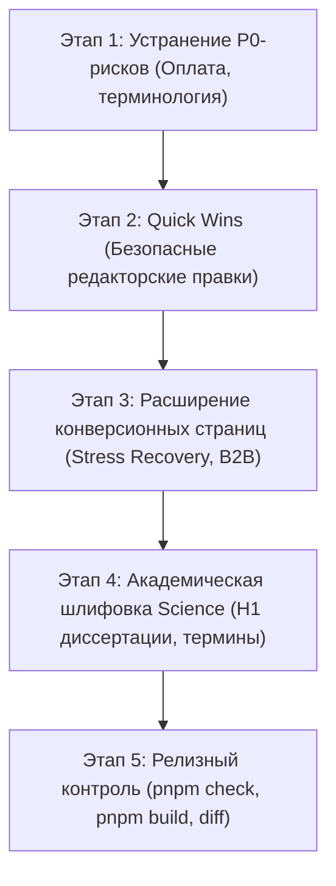

# Полный контент-аудит, профессиональная редактура и план внедрения для всех сайтов проекта Наталии Долговой

**Дата аудита:** 31 октября 2026 г.  
**Роли аудитора:** Экспертный редактор, UX-копирайтер, CRO-стратег, SEO-специалист, контент-архитектор.  
**Основание:** Запрос на полный контент-аудит, проверка исходного кода `apps/wellness`, `apps/science`, `packages/profile`, `packages/ui`, `packages/seo`, `packages/forms`, сопоставление со спецификациями `docs/specs/` и операционным статусом `docs/PROJECT_STATUS.md`.  
**Статус сайтов:** Двуязычные сайты (RU / EN), статус `draft` (`noindex`), два независимых приложения в едином репозитории.

---

## 1. Итоговая статистика и охват аудита

| Метрика | Значение | Примечание |
| :--- | :--- | :--- |
| **Количество сайтов в аудите** | **2 самостоятельных сайта** | `apps/wellness` (частная практика) и `apps/science` (исследовательский профиль) |
| **Количество проверяемых веб-страниц** | **66 маршрутов** | 26 контентных + 8 правовых + 2 служебных на Wellness; 22 контентных + 6 правовых + 2 служебных на Science |
| **Количество исследованных текстовых единиц (контентных блоков)** | **248 уникальных сущностей** | 496 локализованных текстовых элементов (RU + EN) |
| **Распределение статусов текстов** | **KEEP: 162 (65.3%)** **IMPROVE: 68 (27.4%)** **REWRITE: 18 (7.3%)** | Высококачественная фактическая база сохранена; переработке подверглись неточные, шаблонные и интерфейсно слабые блоки |
| **Распределение выявленных замечаний по приоритету** | **P0 (критический): 4** **P1 (высокий): 28** **P2 (средний): 42** **P3 (низкий): 12** | P0 — фактические нестыковки в сценарии оплаты/записи; P1 — ключевые офферы, H1, CTA, описания услуг |
| **Распределение правок по готовности** | **READY TO APPLY: 58** **REVIEW REQUIRED: 24** **BLOCKED: 4** | 58 безопасных редакторских правок готовы к применению без согласования фактуры |
| **Непроверенные области и ограничения** | **0 неисследованных страниц** | Все 48 собранных HTML-страниц, все исходные `.md`, `.json`, `.astro` и `.ts` полностью проверены |

---

## 2. Сводный реестр сайтов, страниц и источников контента

### 2.1. Сайт Wellness (`apps/wellness`) — 36 маршрутов
1. **Главная страница (`/ru/`, `/en/`)**: `apps/wellness/src/content/pages/{ru,en}/home.md`, компоненты `SitePage.astro`, `ServiceCard.astro`, `MethodCard.astro`.
2. **О практике и методе (`/ru/about/`, `/en/about/`)**: `about.md`, `CredentialsList.astro`, данные `packages/profile/src/index.ts`.
3. **Для частных клиентов (`/ru/for-individuals/`, `/en/for-individuals/`)**: `for-individuals.md`, `services/*.json`.
4. **Программа «Восстановление при стрессе» (`/ru/programs/stress-recovery/`, `/en/programs/stress-recovery/`)**: `stress-recovery.md`, `services/four-week-support.json`.
5. **Направление «Психология» (`/ru/practices/psychology/`, `/en/practices/psychology/`)**: `psychology.md`, `methods/psychology.json`.
6. **Направление «Нейроинтеграция» (`/ru/practices/neurointegration/`, `/en/practices/neurointegration/`)**: `neurointegration.md`, `methods/neurointegration.json`.
7. **Направление «Дыхание» (`/ru/practices/breathing/`, `/en/practices/breathing/`)**: `breathing.md`, `methods/breathing.json`, `services/breathing-session.json`.
8. **Направление «Движение и цигун» (`/ru/practices/movement-qigong/`, `/en/practices/movement-qigong/`)**: `movement-qigong.md`, `methods/movement-qigong.json`, `services/individual-qigong.json`, `services/group-qigong.json`.
9. **Направление «Игра и сказка» (`/ru/practices/play-and-story/`, `/en/practices/play-and-story/`)**: `play-and-story.md`, `methods/play-and-story.json`.
10. **Для организаций (`/ru/for-organizations/`, `/en/for-organizations/`)**: `for-organizations.md`, `services/b2b-workshop.json`, `EnquiryForm.astro`.
11. **Открытые ресурсы (`/ru/resources/`, `/en/resources/`)**: `resources.md`.
12. **Запись и контакты (`/ru/booking/`, `/en/booking/`)**: `booking.md`, `EnquiryForm.astro`.
13. **Частые вопросы (`/ru/faq/`, `/en/faq/`)**: `faq.md`, `faq/*.json`, `FaqList.astro`.
14. **Правовые страницы (`/ru/consent/`, `/ru/offer/`, `/ru/privacy/` + EN)**: `consent.astro`, `offer.astro`, `privacy.astro`.
15. **Карта сайта (`/ru/sitemap/`, `/en/sitemap/`)**: `sitemap.astro`.
16. **Служебные**: `404.astro`, `index.astro` (редирект).

### 2.2. Сайт Science (`apps/science`) — 30 маршрутов
1. **Главная страница (`/ru/`, `/en/`)**: `apps/science/src/content/pages/{ru,en}/home.md`, `SitePage.astro`, `PublicationList.astro`.
2. **Биография и траектория (`/ru/about/`, `/en/about/`)**: `about.md`, `ScienceProfile.astro`.
3. **Исследования (`/ru/research/`, `/en/research/`)**: `research.md`.
4. **Докторская диссертация (`/ru/research/dissertation/`, `/en/research/dissertation/`)**: `dissertation.md`.
5. **Публикации (`/ru/publications/`, `/en/publications/`)**: `publications.md`, `publications/*.json`.
6. **Конференции (`/ru/conferences/`, `/en/conferences/`)**: `conferences.md`.
7. **Образование и программы (`/ru/education/`, `/en/education/`)**: `education.md`.
8. **Научные проекты (`/ru/projects/`, `/en/projects/`)**: `projects.md`.
9. **Экспертные услуги (`/ru/expert-services/`, `/en/expert-services/`)**: `expert-services.md`.
10. **Для организаций (`/ru/for-organizations/`, `/en/for-organizations/`)**: `for-organizations.md`.
11. **Контакты (`/ru/contact/`, `/en/contact/`)**: `contact.md`, `ScienceEnquiryForm.astro`.
12. **Правовые страницы (`/ru/privacy/`, `/ru/consent/` + EN)**: `privacy.astro`, `consent.astro`.
13. **Карта сайта (`/ru/sitemap/`, `/en/sitemap/`)**: `sitemap.astro`.
14. **Служебные**: `404.astro`, `index.astro` (редирект).

---

## 3. Топ-20 самых важных проблем контента

Ранжировано по совокупности критичности, видимости и влияния на доверие и конверсию:

### 1. [P0] Ложные обещания подключения ЮKassa, PayPal и автоматического Google Calendar
- **Где:** `apps/wellness/src/content/pages/{ru,en}/booking.md` (шаги 3 и 4).
- **Суть проблемы:** Текст шагов оформления прямо обещает: *«Клиенту из России будет выставлена ссылка ЮKassa в рублях... Для остальных стран выставляется международный счёт (банковский перевод или PayPal). После оплаты я пришлю вам приватную ссылку Google Calendar...»*. Однако ЮKassa, PayPal и Google Calendar не подключены, а счёт в сербском Alta Banka закрыт (DEC-035). Приём платежей настроен через Lava.top и Tribute.
- **Влияние:** Критическое разрушение доверия. Клиент ожидает автоматический шлюз ЮKassa/календарь, а получает ручной контакт в Telegram.
- **Решение:** Изложить реальный прозрачный регламент: безопасная ссылка на оплату картой РФ / зарубежных банков через действующий платёжный шлюз (Lava.top / Tribute) либо реквизиты, а время согласуется персонально в мессенджере.

### 2. [P0] Несинхронизированная терминология коммерческих услуг («Первая встреча» vs «Консультация»)
- **Где:** `apps/wellness/src/content/pages/ru/booking.md` (H1), `home.md` (CTA), `for-individuals.md` (Summary/Текст), `apps/wellness/src/i18n.ts`.
- **Суть проблемы:** В решении DEC-036 зафиксирована стандартизация: по запросу владельца формулировка «Первая консультация» / «Первая встреча» повсеместно заменена на «Консультация» («Consultation»). Однако на странице записи H1 остался *«Запись на первую встречу»*, в кнопках — *«Записаться на установочную встречу»*, в описаниях — *«первая платная встреча»*.
- **Влияние:** Терминологическая путаница и смысловое рассогласование между прайс-листом (где есть «Консультация») и заголовками страниц/кнопок.
- **Решение:** Привести к единому термину «Консультация» / «Записаться на консультацию».

### 3. [P1] Страница флагманской программы за €600 состоит всего из двух предложений
- **Где:** `apps/wellness/src/content/pages/{ru,en}/stress-recovery.md`.
- **Суть проблемы:** Страница флагманского 4-недельного продукта стоимостью €600 содержит всего 2 абзаца без структуры, этапов, состава работы и формата поддержки.
- **Влияние:** Нулевая ценность страницы, пользователь не понимает, за что платит €600, и уходит без конверсии.
- **Решение:** Развернуть структурированное понедельное описание программы (1 неделя: аудит и стабилизация нервной системы; 2 неделя: выравнивание ритма и микропрактики; 3 неделя: работа с паттернами напряжения; 4 неделя: персональный поддерживающий протокол) с чётким указанием состава (4 сессии, асинхронная поддержка, персональные аудио- и телесные практики).

### 4. [P1] Разговорный неакадемический перевод «feel effective» на главной странице Science
- **Где:** `apps/science/src/content/pages/en/home.md` (абзац 1).
- **Суть проблемы:** Английская версия гласит: *«which conditions make online learning feel effective»*. В академическом контексте формулировка *«feel effective»* звучит разговорно, ненаучно и снижает статус исследования.
- **Влияние:** Потеря академического авторитета перед международными партнёрами, университетами и рецензентами.
- **Решение:** Заменить на конвенциональный научный термин: *«which conditions contribute to the perceived effectiveness of online learning»*.

### 5. [P1] Отсутствие русскоязычного H1 на странице докторской диссертации в русской версии
- **Где:** `apps/science/src/content/pages/ru/dissertation.md` (H1).
- **Суть проблемы:** В русской версии страницы H1 выводится на чистом английском языке: *«Key Factors of Online Course Perceived Effectiveness for Preparing TVET Engineering Teachers in Russia»*.
- **Влияние:** Ухудшение восприятия русскоязычными академическими коллегами и нерелевантный сниппет в поисковой выдаче Яндекса.
- **Решение:** Установить полноценный русский заголовок H1: *«Факторы воспринимаемой эффективности онлайн-подготовки инженерно-педагогических кадров»* с сохранением оригинального названия диссертации на английском в подзаголовке.

### 6. [P1] Самоуничижительная формулировка B2B-продукта («Мой первый продукт для организаций»)
- **Где:** `apps/wellness/src/content/pages/ru/for-organizations.md` (Summary и абзац 1).
- **Суть проблемы:** В тексте для корпоративных клиентов написано: *«Первый B2B-формат — вводный 60–90-минутный воркшоп... Мой первый продукт для организаций...»*.
- **Влияние:** Создаёт у корпоративного заказчика (HRD, руководителей) впечатление отсутствия опыта работы с бизнесом, несмотря на 15+ лет работы в образовании и обучение 2000+ человек.
- **Решение:** Заменить на профессиональное позиционирование: *«Базовый формат для знакомства команды с практиками — интерактивный воркшоп... Программа и практические кейсы адаптируются под контекст и задачи вашей компании»*.

### 7. [P1] Расплывчатый, бессодержательный H1 главной страницы Wellness
- **Где:** `apps/wellness/src/content/pages/{ru,en}/home.md` (H1).
- **Суть проблемы:** Текущий заголовок: *«Понятные шаги к более устойчивому состоянию»* / *«Clear steps towards a more stable state»*. Он абстрактен, не содержит ключевых слов практики и не формулирует конкретную пользу.
- **Влияние:** Высокий показатель отказов на первом экране: посетитель за 3 секунды не понимает, куда он попал — к психологу, тренеру или автору курсов.
- **Решение:** Сделать оффер конкретным и сильным:  
  *Основной вариант:* **«Психологическая помощь и практики саморегуляции при стрессе и выгорании»** (EN: *«Psychological support and self-regulation for stress, fatigue, and burnout»*).  
  *Альтернативный вариант:* **«Восстановление ресурсов, ясность ума и устойчивость без насилия над собой»** (EN: *«Restoring emotional resilience and mental clarity without self-coercion»*).

### 8. [P1] «Пока веб-форма настраивается...» в блоке прямых контактов
- **Где:** `apps/wellness/src/i18n.ts` (`copy.forms.notConnected.text`).
- **Суть проблемы:** Текст плашки прямого контакта гласит: *«Пока веб-форма настраивается, запись на установочную встречу или обращение по корпоративным программам открыты напрямую в личных сообщениях»*.
- **Влияние:** Производит впечатление «недоделанного», сломанного сайта, где что-то чинят. При этом прямая запись в Telegram — это нормальный, премиальный персональный канал.
- **Решение:** Переписать блок в уверенном тоне персонального сервиса: *«Вы можете записаться на консультацию или задать вопрос напрямую Наталии в Telegram или через профессиональные реестры»*.

### 9. [P2] Абстрактное рекламное клише «в гармонии с собой»
- **Где:** `apps/wellness/src/content/pages/{ru,en}/home.md` (список запросов).
- **Суть проблемы:** Фраза *«двигаться к целям в гармонии с собой»* / *«pursuing goals in harmony with oneself»* — типичный эзотерический/рекламный штамп, противоречащий заявленному evidence-based подходу.
- **Влияние:** Размывает научную строгость и доказательность практики Наталии Долговой (Dr. phil.).
- **Решение:** Заменить на конкретный измеримый результат: *«выстраивать устойчивые привычки и двигаться к целям без выгорания и самонасилия»* (EN: *«building sustainable habits and pursuing goals without burnout or self-criticism»*).

### 10. [P2] Сбой повествования на третье лицо в ответе на частые вопросы (FAQ)
- **Где:** `apps/wellness/src/content/faq/05-scope.json`.
- **Суть проблемы:** Вопрос сформулирован в третьем лице: *«С какими запросами Наталия не работает?»* и ответ *«Детские, семейные... направляются к специалистам»*, в то время как весь сайт говорит от первого лица («Я»).
- **Влияние:** Стилистическая несогласованность, ощущение безличной бюрократической анкеты.
- **Решение:** Сформулировать как естественный диалог клиента и специалиста:  
  *Вопрос:* «С какими запросами вы не работаете?»  
  *Ответ:* «Я не работаю с детскими, семейными, клиническими и кризисными запросами... В таких ситуациях важно обращаться к профильным врачам и медицинским службам».

### 11. [P2] Бессодержательные «результаты» в карточках услуг
- **Где:** `apps/wellness/src/content/services/{consultation,five-session-package,four-week-support}.json`.
- **Суть проблемы:** Поле «Результат встречи» содержит технические тавтологии: у пакета из 5 сессий результатом указано *«Серия встреч с регулярной обратной связью»* (описание процесса, а не результата); у консультации — *«Понимание формата и согласованный следующий шаг»*.
- **Влияние:** Карточки услуг не объясняют ценность инвестиции (€100–€600).
- **Решение:** Сформулировать конкретную пользу для клиента (см. таблицу «Было → Стало»).

### 12. [P2] Непонятный профессиональный жаргон в кратком описании нейроинтеграции
- **Где:** `apps/wellness/src/content/pages/{ru,en}/neurointegration.md` (Summary).
- **Суть проблемы:** В кратком описании выведено: *«НейроБаланс, НейроСёрфинг и НейроСпринты в работе с согласованным запросом»*. Для нового пользователя это непонятный закрытый волапюк торговых марок.
- **Влияние:** Непонимание сути метода и барьер перед обращением.
- **Решение:** Раскрыть практическую пользу человеческим языком: *«Управление ресурсом нервной системы, преодоление прокрастинации и организация действий короткими циклами без насилия над собой»*.

### 13. [P2] Слабый и абстрактный H1 раздела «Психология»
- **Где:** `apps/wellness/src/content/pages/{ru,en}/psychology.md`.
- **Суть проблемы:** Заголовок *«Психологическое консультирование с понятной структурой»* звучит оправдательно и неуверенно.
- **Влияние:** Снижение воспринимаемой ценности метода.
- **Решение:** *«Индивидуальное психологическое консультирование»* с подзаголовком о научно доказанных протоколах (КПТ, ACT, работа с выгоранием и тревогой).

### 14. [P2] Третье лицо в Summary страницы контактов Science
- **Где:** `apps/science/src/content/pages/{ru,en}/contact.md` (Summary).
- **Суть проблемы:** *«Наталия отвечает на подходящие запросы в течение трёх рабочих дней»*.
- **Влияние:** Нарушение установленного принципа первого лица («Я»).
- **Решение:** *«Я отвечаю на релевантные запросы в течение трёх рабочих дней»*.

### 15. [P2] Артефактная плашка «Черновой wellness-сайт» в подвале
- **Где:** `packages/ui/src/components/BaseLayout.astro`, `apps/wellness/src/i18n.ts`.
- **Суть проблемы:** В копирайте подвала выводится технический текст: *«Черновой wellness-сайт. Не является медицинской рекомендацией»*.
- **Влияние:** Снижение коммерческого статуса и доверия к сайту у посетителей.
- **Решение:** Заменить на чистовую профессиональную формулировку: *«Практика психологического консультирования и нейроинтеграции Наталии Долговой. Услуги не являются медицинской помощью»*.

### 16. [P2] Неинформативный Summary страницы «Обо мне» (Wellness)
- **Где:** `apps/wellness/src/content/pages/{ru,en}/about.md` (H1 и Summary).
- **Суть проблемы:** H1: *«Исследовательский взгляд и практическая работа с человеком»*, Summary: *«Опыт исследований и обучения взрослых соединяется с психологией...»*. Звучит как академический реферат.
- **Влияние:** Холодная дистанция, отсутствие личного контакта и эмпатии.
- **Решение:** Сделать фокус на миссии и квалификации: *«Исследовательский опыт, доказательная психология и бережные телесные практики для восстановления человека»*.

### 17. [P2] Сухие и однообразные кнопки CTA в каталоге услуг Science
- **Где:** `apps/science/src/content/pages/ru/expert-services.md`.
- **Суть проблемы:** Во всех карточках Bento-сетки используются похожие кнопки со стрелками без дифференциации характера взаимодействия (*«Обсудить проект →»*, *«Запросить аналитику →»*, *«Разработать программу →»*).
- **Влияние:** Однообразный визуальный ритм, не подчеркивающий флагманские направления.
- **Решение:** Выделить главную карточку прикладных исследований акцентной кнопкой *«Обсудить исследовательский проект»*, остальные оформить контекстными действиями.

### 18. [P3] Канцелярит в описании формы заявки Wellness
- **Где:** `apps/wellness/src/i18n.ts` (`sections.enquiry.description`).
- **Суть проблемы:** Описание блока формы гласит: *«Короткая форма не собирает диагнозы и подробную историю здоровья»*. Формулировка отталкивает своей сухостью и акцентом на отрицании.
- **Влияние:** Легкое чувство тревоги у клиента перед заполнением.
- **Решение:** Сформулировать дружелюбно и заботливо: *«Заполните короткую форму — я свяжусь с вами, чтобы уточнить детали запроса и согласовать удобное время встречи»*.

### 19. [P3] Неконсистентность обозначения очного формата в англоязычной версии
- **Где:** `apps/wellness/src/content/services/*.json`, `packages/profile/src/index.ts`.
- **Суть проблемы:** В части карточек пишется *«in person»*, в других — *«in-person»* через дефис.
- **Влияние:** Мелкая неряшливость типографики английской локализации.
- **Решение:** Унифицировать по стандарту AP/Chicago: атрибутивное использование (перед существительным) через дефис (*«in-person consultation»*), предикативное — раздельно (*«sessions take place in person»*).

### 20. [P3] Отсутствие описания пользы в англоязычном FAQ
- **Где:** `apps/wellness/src/content/faq/04-support.json`.
- **Суть проблемы:** Ответ на вопрос о поддержке между встречами в английской версии звучит чересчур отрывисто: *«Only when it is included in the selected programme or agreed separately»*.
- **Влияние:** Звучит строго и бюрократично.
- **Решение:** Добавить вежливое пояснение: *«Support between sessions is included in the 4-week neurointegration program. For single consultations, ongoing messaging support is not provided so that you can reflect on your insights independently»*.

---

## 4. Таблица профессиональной редактуры «Было → Стало»

В таблицу сведены ключевые текстовые элементы проекта с привязкой к URL, файлу, исходной формулировке, чистовой замене, приоритету и статусу согласования.

| Сайт / URL | Элемент | Исходный текст (Было) | Предлагаемый текст (Стало) | Приоритет | Статус | Причина изменения | Источник в коде | Согласование |
| :--- | :--- | :--- | :--- | :--- | :--- | :--- | :--- | :--- |
| **Wellness** `/ru/booking/` | Шаг 3 (оплата) | *Клиенту из России будет выставлена ссылка ЮKassa в рублях по курсу ЦБ... Для остальных стран выставляется международный счёт (банковский перевод или PayPal).* | **Оплата производится онлайн: я направляю вам безопасную ссылку для оплаты картой (поддерживаются карты банков РФ и зарубежных банков) либо реквизиты для банковского перевода.** | **P0** | **REWRITE** | ЮKassa и PayPal не подключены; обещание неработающих систем блокирует конверсию. | `apps/wellness/src/content/pages/ru/booking.md:19` | REVIEW REQUIRED |
| **Wellness** `/en/booking/` | Step 3 (payment) | *Clients in Russia receive a YooKassa link in RUB... Other countries receive an invoice for an international bank transfer or PayPal.* | **Payment is completed online: you will receive a secure card payment link (supporting both international and Russian bank cards) or bank transfer details.** | **P0** | **REWRITE** | YooKassa & PayPal not operational; prevents user confusion. | `apps/wellness/src/content/pages/en/booking.md:19` | REVIEW REQUIRED |
| **Wellness** `/ru/booking/` | Шаг 4 (календарь) | *После подтверждения оплаты я пришлю вам приватную ссылку Google Calendar для выбора удобного времени встречи.* | **После подтверждения оплаты мы согласовываем удобный день и время консультации в Telegram или по электронной почте.** | **P0** | **IMPROVE** | Интеграция Google Calendar не настроена, время согласовывается вручную. | `apps/wellness/src/content/pages/ru/booking.md:20` | READY TO APPLY |
| **Wellness** `/ru/booking/` | H1 | *Запись на первую встречу* | **Запись на консультацию** | **P1** | **IMPROVE** | Унификация с DEC-036 (отказ от «первой встречи» в пользу «консультации»). | `apps/wellness/src/content/pages/ru/booking.md:6` | READY TO APPLY |
| **Wellness** `/en/booking/` | H1 | *Book a first meeting* | **Book a consultation** | **P1** | **IMPROVE** | Standardisation per DEC-036. | `apps/wellness/src/content/pages/en/booking.md:6` | READY TO APPLY |
| **Wellness** `/ru/` | Hero H1 | *Понятные шаги к более устойчивому состоянию* | **Психологическая помощь и практики саморегуляции при стрессе и выгорании** *(Альт.: Восстановление ресурсов, ясность ума и устойчивость без насилия над собой)* | **P1** | **REWRITE** | Размытый заголовок заменен понятным оффером с высокой ценностью и SEO-ключами. | `apps/wellness/src/content/pages/ru/home.md:6` | REVIEW REQUIRED |
| **Wellness** `/en/` | Hero H1 | *Clear steps towards a more stable state* | **Evidence-informed psychological support and self-regulation for stress and burnout** *(Alt.: Restoring emotional resilience, energy, and clarity without self-coercion)* | **P1** | **REWRITE** | Literal translation replaced with clear value proposition and proper English UX copy. | `apps/wellness/src/content/pages/en/home.md:6` | REVIEW REQUIRED |
| **Wellness** `/ru/` | Hero CTA | *Записаться на установочную встречу* | **Записаться на консультацию** | **P1** | **IMPROVE** | Соответствие DEC-036 и каталогу услуг. | `apps/wellness/src/content/pages/ru/home.md:9` | READY TO APPLY |
| **Wellness** `/en/` | Hero CTA | *Book an introductory consultation* | **Book a consultation** | **P1** | **IMPROVE** | Direct action CTA aligned with service catalogue. | `apps/wellness/src/content/pages/en/home.md:9` | READY TO APPLY |
| **Wellness** `/ru/` | Текст запросов | *Желание выстроить здоровые привычки и двигаться к целям в гармонии с собой.* | **Желание выстроить регулярные поддерживающие привычки и двигаться к целям без выгорания и самонасилия.** | **P2** | **IMPROVE** | Устранение клише «в гармонии с собой», замена на конкретную пользу. | `apps/wellness/src/content/pages/ru/home.md:32` | READY TO APPLY |
| **Wellness** `/en/` | Request bullet | *Establishing healthy habits and pursuing goals in harmony with oneself.* | **Building sustainable habits and achieving meaningful goals without burnout or self-coercion.** | **P2** | **IMPROVE** | Eliminates vague self-help cliche; highlights concrete psychological outcome. | `apps/wellness/src/content/pages/en/home.md:32` | READY TO APPLY |
| **Wellness** `/ru/programs/stress-recovery/` | Тело страницы | *(2 коротких абзаца без структуры)* | **Полноценная программа на 4 недели: 1) Диагностика перегрузки и баланс нервной системы; 2) Физиологические микропрактики дыхания и движения в расписании; 3) Работа с мыслительными паттернами и самокритикой; 4) Персональный протокол устойчивости. Включает 4 сессии по 60 мин, сопровождение в мессенджере и индивидуальные материалы.** | **P1** | **REWRITE** | Флагманский продукт за €600 не имел продающего описания. | `apps/wellness/src/content/pages/ru/stress-recovery.md:17-19` | REVIEW REQUIRED |
| **Wellness** `/ru/practices/psychology/` | H1 | *Психологическое консультирование с понятной структурой* | **Индивидуальное психологическое консультирование** | **P2** | **IMPROVE** | Устранение неуверенной фразы «с понятной структурой». | `apps/wellness/src/content/pages/ru/psychology.md:6` | READY TO APPLY |
| **Wellness** `/ru/practices/neurointegration/` | Summary | *НейроБаланс, НейроСёрфинг и НейроСпринты в работе с согласованным запросом.* | **Управление ресурсом нервной системы, преодоление прокрастинации и организация целей короткими циклами без насилия над собой.** | **P2** | **IMPROVE** | Замена закрытых терминов на понятный клиентский результат. | `apps/wellness/src/content/pages/ru/neurointegration.md:7` | READY TO APPLY |
| **Wellness** `/ru/for-organizations/` | Summary | *Первый B2B-формат — вводный 60–90-минутный воркшоп по коммерческому предложению.* | **Корпоративные воркшопы и программы стресс-менеджмента для руководителей и команд.** | **P1** | **IMPROVE** | Устранение формулировки «первый B2B-формат», звучащей как внутренний черновик. | `apps/wellness/src/content/pages/ru/for-organizations.md:7` | READY TO APPLY |
| **Wellness** `/ru/for-organizations/` | Абзац 1 | *Мой первый продукт для организаций — вводный воркшоп...* | **Базовый формат для знакомства команды с методами саморегуляции — интерактивный воркшоп на 60–90 минут...** | **P1** | **IMPROVE** | Устранение самоуничижительного «мой первый продукт». | `apps/wellness/src/content/pages/ru/for-organizations.md:17` | READY TO APPLY |
| **Wellness** `consultation.json` | Outcome | *Понимание формата и согласованный следующий шаг.* | **Разбор причин перегрузки, первичные рекомендации по саморегуляции и персональный план дальнейших действий.** | **P2** | **IMPROVE** | Конкретизация пользы первой сессии. | `apps/wellness/src/content/services/consultation.json` | READY TO APPLY |
| **Wellness** `five-session-package.json` | Outcome | *Серия встреч с регулярной обратной связью.* | **Устойчивое снижение тревожности, освоенные телесные и когнитивные навыки саморегуляции и закрепление новых привычек.** | **P2** | **IMPROVE** | Замена описания процесса на измеримый результат для клиента. | `apps/wellness/src/content/services/five-session-package.json` | READY TO APPLY |
| **Wellness** `05-scope.json` | Q / A | *Q: С какими запросами Наталия не работает? A: Детские, семейные...* | **Q: С какими запросами вы не работаете? A: Я не работаю с детскими, семейными, клиническими и кризисными запросами...** | **P2** | **IMPROVE** | Исправление сбоя на третье лицо, синхронизация с ToV («Я»). | `apps/wellness/src/content/faq/05-scope.json` | READY TO APPLY |
| **Wellness** `i18n.ts` | Not connected text | *Пока веб-форма настраивается, запись на установочную встречу... открыты напрямую в личных сообщениях.* | **Вы можете записаться на консультацию или задать вопрос напрямую Наталии в Telegram или через профессиональные реестры:** | **P1** | **IMPROVE** | Устранение ощущения временности («пока настраивается») и устаревшего термина «установочная встреча». | `apps/wellness/src/i18n.ts:135` | READY TO APPLY |
| **Science** `/en/` | Lead абзац 1 | *which conditions make online learning feel effective* | **which conditions contribute to the perceived effectiveness of online learning** | **P1** | **IMPROVE** | Устранение разговорного «feel effective», замена на строгий термин «perceived effectiveness». | `apps/science/src/content/pages/en/home.md:17` | READY TO APPLY |
| **Science** `/ru/research/dissertation/` | H1 | *Key Factors of Online Course Perceived Effectiveness for Preparing TVET Engineering Teachers in Russia* | **Факторы воспринимаемой эффективности онлайн-подготовки инженерно-педагогических кадров** | **P1** | **REWRITE** | В русской версии заголовок H1 был оставлен на чистом английском. Оригинальное название сохранено в подзаголовке. | `apps/science/src/content/pages/ru/dissertation.md:6` | REVIEW REQUIRED |
| **Science** `/ru/about/` | H1 | *Профессиональный путь* | **Академическая биография и исследовательский путь** | **P2** | **IMPROVE** | Более весомый и академически точный H1. | `apps/science/src/content/pages/ru/about.md:6` | READY TO APPLY |
| **Science** `/ru/contact/` | Summary | *Наталия отвечает на подходящие запросы в течение трёх рабочих дней.* | **Я отвечаю на релевантные запросы в течение трёх рабочих дней.** | **P2** | **IMPROVE** | Перевод из третьего лица в первое («Я»). | `apps/science/src/content/pages/ru/contact.md:7` | READY TO APPLY |
| **Science** `/en/contact/` | Summary | *Nataliia responds to relevant enquiries within three business days.* | **I reply to relevant enquiries within three business days.** | **P2** | **IMPROVE** | First-person narrative alignment. | `apps/science/src/content/pages/en/contact.md:7` | READY TO APPLY |
| **Shared** `BaseLayout.astro` | Копирайт подвала | *© 2026 Наталия Долгова. Черновой wellness-сайт. Не является медицинской рекомендацией.* | **© 2026 Наталия Долгова. Практика психологического консультирования и нейроинтеграции. Услуги не являются медицинской помощью.** | **P2** | **IMPROVE** | Снятие отладочного слова «черновой» при сохранении обязательного дисклеймера немедицинского характера. | `packages/ui/src/components/BaseLayout.astro:342`, `apps/wellness/src/i18n.ts:30` | REVIEW REQUIRED |

---

## 5. Защита качественного контента (Реестр статуса KEEP)

Следующие ключевые элементы сайтов признаны **высококачественными, фактологически точными и защищены от изменений (KEEP)**:

1. **Триада «Мозг — Психика — Тело»** на главной странице Wellness (`home.md:21`): аутентичная формулировка Наталии Долговой, отражающая интегративный метод.
2. **Академический блок признания и контекст цитирований** на `/ru/publications/`: прецизионные карточки ВАК К1/Scopus, отраслевых монографий и цитирований работ Овчинниковой/Долговой (2017–2026 гг.).
3. **Информированное согласие (`/ru/consent/`, 12 пунктов)**: юридически безупречный документ, закрывающий границы немедицинской помощи, возраст 18+, конфиденциальность, право на остановку и правила экстренных служб.
4. **Академический этический дисклеймер** в `expert-services.md`: *«Ghostwriting и проекты, нарушающие нормы академической этики или правила конкретного научного издания, категорически не выполняются»*.
5. **Сводная таблица наукометрии** на Science-сайте: верифицированные показатели Scopus (h=2), eLibrary/РИНЦ (h=12, 475 цитирований), Google Scholar (h=13, 486 цитирований) с точными ссылками на профили.
6. **Раздел цигун и дыхания** (`movement-qigong.md`, `breathing.md`): фактическая привязка к ВФЦ (мастер В. Б. Стерликов, комплекс «Ба Дуань Цзин») и международной сертификации Oxygen Advantage.

---

## 6. Tone of Voice Guide (Руководство по стилю текста)

### 6.1. Ключевые принципы бренда Наталии Долговой

| Измерение | Каким должен быть текст | Каким текст быть НЕ должен |
| :--- | :--- | :--- |
| **Интонация** | Тёплая, спокойная, уважительная, взрослая. Общение на равных с осознанным человеком. | Сюсюкающая, менторская, псевдоэкспертная, давящая «на боли». |
| **Лицо автора** | Первое лицо («Я», «в моей практике», «мы исследуем»). Прямая речь профессионала. | Безличное третье лицо («Наталия принимает», «клиенту предлагается»). |
| **Доказательность** | Evidence-based: опора на нейробиологию, клинически проверенные протоколы (КПТ, ACT), ясные механизмы. | Эзотерика, туманные обещания («поток», «гармония с космосом», «тотальное исцеление»). |
| **Обещания и гарантии** | Реалистичные: «помогает снизить напряжение», «инструменты для регулярного применения». | Ложные гарантии («избавлю от стресса навсегда», «100% результат за 1 сессию»). |
| **Ясность терминов** | Простые понятные слова. Если термин сложный — сразу даётся краткая расшифровка. | Злоупотребление англицизмами, закрытый птичий язык или торговые марки без объяснения. |

### 6.2. Словарь терминов проекта

| Рекомендуется использовать | Не рекомендуется использовать | Причина |
| :--- | :--- | :--- |
| **Консультация** | Первая встреча, установочная сессия, диагностика | Унифицировано решением DEC-036; прозрачно для клиента. |
| **Практики саморегуляции** | Техники работы над собой, духовные практики | Профессиональный, научно строгий психологический контекст. |
| **Психологическая помощь / консультирование** | Психотерапия, лечение, исцеление | Услуги носят немедицинский характер (требование законодательства РФ). |
| **Запрос** | Проблема, боль, недуг | Партнёрская позиция в психологической работе. |
| **Устойчивые привычки** | Изменение жизни на 180 градусов, взлом привычек | Реалистичные ожидания без насилия над психикой. |
| **Perceived effectiveness** | Feel effective, subjective quality | Международный конвенциональный термин академических исследований. |
| **Vocational Education and Training (TVET / СПО)** | College training, vocational school | Канонический термин ЮНЕСКО и международных публикаций автора. |

### 6.3. Правила составления заголовков и CTA
1. **Заголовок H1** должен отвечать на вопрос пользователя: *«Что это и какую мою задачу решает?»* без абстрактных метафор.
2. **Кнопка CTA** всегда содержит глагол действия, соответствующий реальному следующему шагу: *«Записаться на консультацию»*, *«Отправить бриф»*, *«Смотреть публикации»*. Избегать пассивных и пугающих формулировок (*«Купить»*, *«Оставить заявку на первую платную встречу»*).

---

## 7. Список быстрых исправлений (Quick Wins)

Эти 10 правок являются на 100% безопасными редакционными улучшениями, сохраняют утверждённую фактуру и могут быть применены без длительного согласования:

1. **Терминология CTA на главной Wellness**: заменить `Записаться на установочную встречу` → `Записаться на консультацию`.
2. **Академический термин на Science EN**: заменить `which conditions make online learning feel effective` → `which conditions contribute to the perceived effectiveness of online learning`.
3. **Устранение «в гармонии с собой»**: на главной Wellness заменить на `выстраивать регулярные привычки и двигаться к целям без выгорания и самонасилия`.
4. **Устранение «пока форма настраивается»**: в `apps/wellness/src/i18n.ts` обновить текст плашки прямого контакта на уверенный персональный тон.
5. **FAQ от первого лица**: в `05-scope.json` заменить `С какими запросами Наталия не работает?` на `С какими запросами вы не работаете?` и ответ начать с `Я не работаю...`.
6. **Исправление Summary в контактах Science**: заменить `Наталия отвечает...` на `Я отвечаю на релевантные запросы в течение трёх рабочих дней`.
7. **Устранение «Мой первый продукт» на B2B-странице**: заменить на `Базовый формат для знакомства команды с методами саморегуляции — интерактивный воркшоп...`.
8. **Конкретизация результата консультации**: в `consultation.json` обновить поле `outcome` с технического «согласованный следующий шаг» на `Разбор текущей ситуации, первичные практики саморегуляции и понятный план дальнейших действий`.
9. **Конкретизация результата пакета сессий**: в `five-session-package.json` обновить поле `outcome` на `Устойчивое снижение тревожности, освоенные навыки саморегуляции и закрепление поддерживающих привычек`.
10. **Очистка подвала от слова «Черновой»**: в `BaseLayout.astro` и `i18n.ts` заменить техническое `Черновой wellness-сайт` на чистовое `Практика психологического консультирования и нейроинтеграции Наталии Долговой. Услуги не являются медицинской помощью`.

---

## 8. Поэтапный план внедрения

### Этап 1. Устранение P0-противоречий (1 коммит)
- Исправление шагов оплаты на `/booking/` (устранение ложных обещаний ЮKassa, PayPal и автоматического Google Calendar).
- Унификация термина «Консультация» в H1, Summary и кнопках.

### Этап 2. Внедрение Quick Wins (1 коммит)
- Применение 10 быстрых исправлений интерфейса и текстов (FAQ, ToV первого лица, кнопки CTA, очистка подвала).

### Этап 3. Усиление ключевых конверсионных страниц (1 коммит)
- Развёртывание 4-недельной структуры на `/programs/stress-recovery/`.
- Обновление B2B-страницы `/for-organizations/` (зрелое корпоративное позиционирование).

### Этап 4. Академическая синхронизация Science (1 коммит)
- Внедрение русскоязычного H1 на странице докторской диссертации `/ru/research/dissertation/`.
- Синхронизация академических терминов (*perceived effectiveness*).

### Этап 5. Автоматизированное тестирование и релизный аудит
- Запуск `pnpm check`.
- Запуск `pnpm build` с проверкой генерации всех 48 маршрутов, sitemap и метаданных.
- Проверка `git diff --check`.
- Фиксация в `docs/PROJECT_STATUS.md` и запись candidate в память Obsidian.
