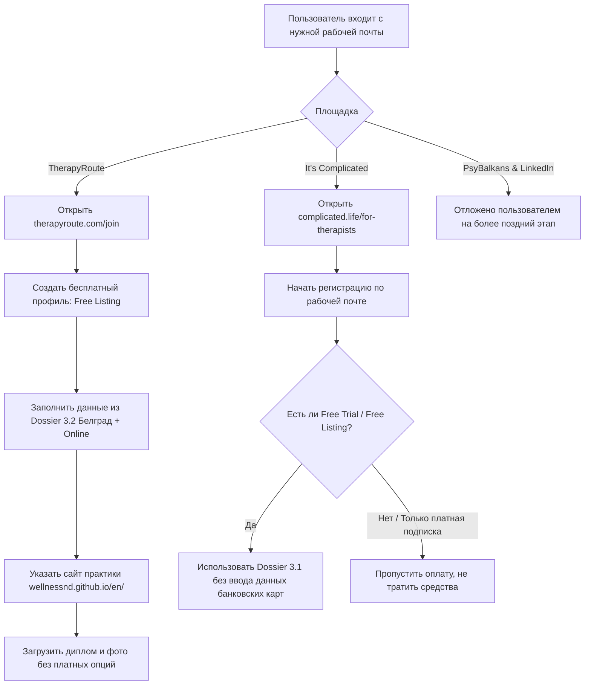

# План регистрации и актуализации профилей Наталии на профильных платформах

## Описание задачи и цели

Цель: сформировать присутствие Наталии Долговой на ключевых международных, экспатских и B2B-платформах для привлечения клиентов в Wellness-практику, верификации её профессионального статуса и расширения поискового охвата.

Пользователь запросил:
1. Проверить текущее наличие регистрации Наталии на 4 ресурсах:
   - **It's Complicated** (`complicated.life`)
   - **TherapyRoute** (`therapyroute.com`)
   - **«Слушать и слышать» — PsyBalkans** (`psybalkans.com`)
   - **LinkedIn Services** (`linkedin.com/services`)
2. Подготовить полные пакеты регистрационных данных (тексты, теги, цены, квалификации, фото).
3. Обеспечить регламент заполнения профилей после входа пользователя с рабочей почты.

---

## 1. Результаты аудита присутствия

| Платформа | Статус Наталии | Модель монетизации площадки | Текущие данные / Примечание |
| :--- | :--- | :--- | :--- |
| **It's Complicated** | ❌ **Не зарегистрирована** | Платная подписка терапевта (€29.90 – €79.90 / мес) + комиссия с первой оплаты | Профиль отсутствует. Международная аудитория, экспаты в Европе, поддержка русского и английского языков. Требуется верификация дипломов. |
| **TherapyRoute** | ❌ **Не зарегистрирована** | Бесплатный базовый тариф / Pro-тариф ($14.33 / мес). **Без комиссии за сессии** | Профиль отсутствует. Каталог Белграда и международный онлайн. Pro-тариф дает verified-бейдж и прямую ссылку на сайт. |
| **PsyBalkans** («Слушать и слышать») | ✅ **Уже зарегистрирована** | Сообщество русскоязычных психологов в Сербии. Модерация через администратора | **Профиль найден в каталоге!** Данные устарели: указана старая цена **45 €/час** (вместо 100 €), отсутствует ссылка на новый сайт и прямой Telegram. |
| **LinkedIn Services** | ⚠️ **Профиль есть, Services не включены** | Бесплатно, без комиссий (встроено в LinkedIn) | Персональный профиль `linkedin.com/in/natalidolgova` активен. Витрина услуг «Providing services» не активирована. Ключевой B2B/руководящий канал. |

---

## 2. Принятые решения пользователя (Decisions Log)

> [!TIP]
> **1. Принцип: только бесплатное присутствие (без лишних затрат при наличии своего сайта)**  
> Пользователь зафиксировал: платить за сторонние каталоги при наличии собственного развитого сайта `wellnessnd.github.io` нецелесообразно. Работаем строго по бесплатным опциям.

> [!NOTE]
> **2. Решение по TherapyRoute**  
> Выбран **бесплатный тариф (Free Listing)**. Он даёт присутствие в каталоге Белграда и онлайн-практиков без необходимости оплачивать Pro-подписку ($14.33/мес).

> [!NOTE]
> **3. Решение по It's Complicated**  
> При регистрации используем только **бесплатные опции / free trial** (без привязки банковских карт и регулярных списаний). Если платформа принудительно требует платную подписку без возможности бесплатного размещения — активацию платного тарифа пропускаем, подготовленные материалы остаются в запасе.

> [!NOTE]
> **4. Решение по PsyBalkans и LinkedIn Services**  
> Рассмотрение и обновление отложены пользователем на более поздний этап («Остальное проверим позже»). Материалы полностью подготовлены и сохранены в досье ниже.

---

## 3. Готовые материалы для регистрации (Dossier)

### 3.1. Платформа It's Complicated (`complicated.life`)

- **Профессиональный титул (Title):** Practical Psychologist, Neurointegration Trainer & Coach, Dr. phil.
- **Языки консультаций (Languages):** Russian (Native), English (Fluent / C1).
- **Локация (Location):** Belgrade, Serbia (Remote / Online + In-person Belgrade).
- **Форматы и цены (Pricing):**
  - Online Psychological Consultation (60 min): **100 €**
  - In-person Psychological Consultation (Belgrade, 60 min): **120 €**
  - Neurointegration Intensive / Burnout Recovery (4-week programme): **600 €**
- **Headline (EN):**
  > Practical Psychologist & Neurointegration Trainer | Cognitive Resilience, Burnout & Life Transitions
- **About Me (EN):**
  > I am a practical psychologist (MPGU, 1080 hrs), neurointegration trainer, and Dr. phil. (Europa-Universität Flensburg). With over 15 years in education and cognitive research, I help high-performing professionals, expats, and leaders navigate stress, burnout, emotional exhaustion, and major life changes.
  >
  > My methodology connects three core dimensions:
  > 1. **The Brain:** understanding neurobiology, nervous system states, and cognitive load;
  > 2. **The Psyche:** working with emotional regulation, unhelpful thinking habits, and personal crises;
  > 3. **The Body:** somatic tools, functional breathing, and restorative qigong for grounded physical well-being.
  >
  > Sessions are held online worldwide or in-person in Belgrade. I do not work with clinical psychiatric diagnoses or child/family therapy, focusing deeply on individual adult change and sustainable performance.
- **Headline (RU):**
  > Практический психолог и тренер по нейроинтеграции | Восстановление при стрессе, выгорании и переменах
- **О себе (RU):**
  > Практический психолог (МПГУ, 1080 ч), тренер по нейроинтеграции и Dr. phil. (PhD, Europa-Universität Flensburg). Помогаю взрослым, руководителям и экспатам справляться с перегрузкой, выгоранием, хронической усталостью и кризисами адаптации.
  >
  > Соединяю три опоры:
  > - **Мозг:** понимание работы нервной системы, когнитивных ресурсов и фокуса;
  > - **Психика:** осознанность, эмоциональная устойчивость и преодоление повторяющихся сценариев;
  > - **Тело:** соматические инструменты, практики дыхания и оздоровительный цигун.
- **Категории / Теги:** Stress Management, Burnout, Life Transitions, Expat Adjustment, Anxiety & Fatigue, Executive & Specialist Coaching, Somatics & Mindfulness.
- **Документы для верификации (загрузка):**
  1. Диплом о профессиональной переподготовке «Практическая психология» (МПГУ, 1080 ч, 2026);
  2. Диплом/сертификат «Тренер по нейроинтеграции» (Институт нейроинтеграции, 250 ч, 2024);
  3. Диплом Dr. phil. (Europa-Universität Flensburg, 2026);
  4. Фотография профиля: `apps/wellness/public/images/natalia-portrait.png`.

---

### 3.2. Платформа TherapyRoute (`therapyroute.com`)

- **Раздел каталога:** Belgrade, Serbia (`/therapists/serbia/belgrade`) + Global Online.
- **Professional Headline:** Nataliia Dolgova, Dr. phil. | Psychologist & Neurointegration Trainer
- **Practice Name:** Private Practice Nataliia Dolgova (Mind · Brain · Body)
- **Practice Address:** Belgrade, Serbia (Stari Grad / Vračar / Online)
- **Fees:** €100 (Online 60 min) / €120 (In-person Belgrade)
- **Session Types:** Individual Adults, Online Video, In-Person.
- **Clientele:** Adults (35+ professionals, expats, leaders, founders).
- **Theoretical Orientation / Modalities:**
  - Neurointegration & Neuroscience-informed practice
  - Somatic & Breathwork therapy
  - Cognitive and behavioral self-regulation skills
  - Acceptance & Commitment principles (ACT)
  - Health Qigong integration
- **Practice Description (EN):**
  > Navigating life transitions, relocation, or sustained career overload can push the nervous system beyond its adaptive capacity. In my Belgrade and online practice, I offer a grounded, multi-level approach to restoring mental clarity, emotional equilibrium, and physical vitality.
  >
  > Rather than relying on purely conversational therapy or superficial wellness tips, we address the interplay between your brain's cognitive reserves, emotional regulation habits, and bodily state. You will gain clarity on what is happening, rebuild internal capacity, and develop actionable self-regulation skills for everyday life.
  >
  > *Qualifications:* Dr. phil. (Europa-Universität Flensburg), Practical Psychologist (MPGU, 1080 hrs), Certified Neurointegration Trainer (250 hrs).
- **Website URL:** `https://wellnessnd.github.io/en/` (RU: `https://wellnessnd.github.io/ru/`)
- **Direct contact:** Telegram `@natali_tvet_pro`.

---

### 3.3. Платформа PsyBalkans («Слушать и слышать» — `psybalkans.com`)

*Поскольку Наталия уже представлена в каталоге, регистрация с нуля не требуется. Требуется направить официальный запрос администраторам сообщества (`psybalkans@gmail.com` или в Telegram координатору).*

#### Проект письма администраторам PsyBalkans

**Тема:** Обновление анкеты специалиста: Наталия Долгова (каталог psybalkans.com)

> Здравствуйте, команда PsyBalkans!
>
> Прошу актуализировать информацию в моей анкете в каталоге специалистов Сербии:
>
> 1. **Имя и регалии:** Наталия Долгова — практический психолог, тренер по нейроинтеграции, Dr. phil. (PhD).
> 2. **Формат работы:** Онлайн по всему миру и очные консультации в Белграде.
> 3. **Стоимость:** 
>    - Онлайн-консультация (60 мин) — **100 €**
>    - Очная консультация в Белграде (60 мин) — **120 €**
> 4. **Ключевой фокус практики:** 
>    Восстановление при стрессе, эмоциональном выгорании, кризисах адаптации и перегрузке у руководителей и специалистов. Работа с триадой: мозг (нейроинтеграция, когнитивные ресурсы), психика (эмоциональная регуляция, жизненные сценарии) и тело (соматические практики, дыхание, оздоровительный цигун).
> 5. **Контакты для записи:**
>    - Прямой Telegram: @natali_tvet_pro (https://t.me/natali_tvet_pro)
>    - Канал: @natalicompass (https://t.me/natalicompass)
>    - Сайт практики: https://wellnessnd.github.io/ru/
>
> В приложении прикрепляю актуальный портрет в высоком разрешении и сканы дипломов (МПГУ «Практическая психология», Институт нейроинтеграции, диплом Dr. phil.).
>
> Спасибо за развитие профессионального сообщества!
> С уважением,  
> Наталия Долгова

---

### 3.4. Витрина услуг LinkedIn Services (`linkedin.com/services`)

Настройка витрины «Providing services» на профиле `https://www.linkedin.com/in/natalidolgova`:

1. **Сервисные категории (до 10 тегов из выпадающего списка LinkedIn):**
   - `Executive Coaching`
   - `Life Coaching`
   - `Career Development Coaching`
   - `Stress Management`
   - `Wellness Consulting`
   - `Educational Consulting`
   - `Personal Development`
   - `Training & Facilitation`
   - `Health Coaching`
   - `Leadership Development`
2. **Work Location:** Belgrade, Serbia + чекбокс ☑️ **I am available to work remotely**.
3. **About / Service Description (EN):**
   > I support executives, entrepreneurs, academic leaders, and specialists navigating complex career transitions, persistent stress, and cognitive exhaustion. 
   >
   > **How I help:**
   > - **Burnout & Stress Recovery:** Science-backed neurointegration and nervous system regulation to regain energy and executive focus;
   > - **Cognitive Resilience & Work Capacity:** Actionable protocols for sustainable performance without chronic overexertion;
   > - **Somatic & Breathwork Techniques:** Practical tools for immediate down-regulation, clarity under pressure, and emotional balance;
   > - **B2B Educational & Well-being Facilitation:** Tailored corporate sessions on cognitive health, preventing workplace fatigue, and adult learning design.
   >
   > **Background:** Dr. phil. (Europa-Universität Flensburg), Practical Psychologist (1,080 hrs), Certified Neurointegration Trainer (250 hrs). Over 15 years designing adult learning and leadership programs.
   >
   > 📍 Based in Belgrade, Serbia | Serving clients globally online.  
   > 🌐 Practice website: wellnessnd.github.io/en/
4. **Настройки обращений:**
   - Чекбокс ☑️ **Allow members you’re not connected with to message you for free** (включить обязательно, чтобы клиенты без платного LinkedIn Premium могли писать напрямую).
5. **Медиафайлы:**
   - Прикрепить портрет и фото МАК-карт / дыхательных практик.

---

## 4. Пошаговый сценарий исполнения (Execution Plan)

Когда пользователь будет готов войти с нужной почты:



---

## 5. План верификации (Verification Plan)

### Автоматические проверки в репозитории
Запуск обязательных проверок целостности и чистоты кода:
```powershell
pnpm check
pnpm build
git diff --check
```

### Ручные проверки после заполнения
1. **It's Complicated**: проверка, что анкета отправлена на review, статус профиля отображается как Pending verification.
2. **TherapyRoute**: проверка публичной доступности карточки в подразделе Белграда (`therapyroute.com/therapists/serbia/belgrade`).
3. **PsyBalkans**: получение ответа от администраторов, проверка изменения цены с 45€ на 100€ на странице `psybalkans.com/psychologists/`.
4. **LinkedIn Services**: проверка профиля в режиме инкогнито — наличие блока «Providing services» и кнопки «Request services / Message».
