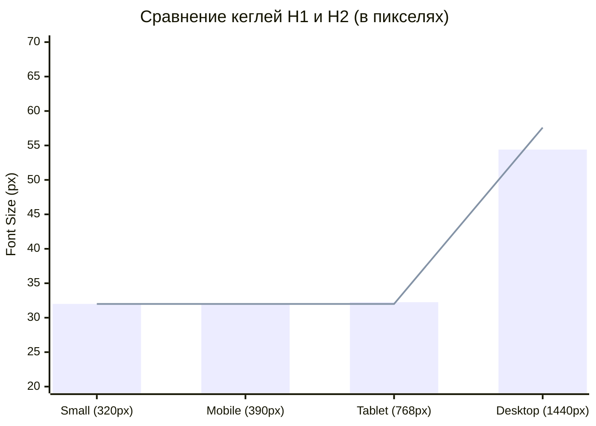

# 6.1. TYPOGRAPHY CONSISTENCY & DESIGN TOKENS AUDIT
**Проект:** Сайты Наталии Долговой (`wellness` и `science`)  
**Дата проведения:** 31 октября 2026 г.  
**Инструмент замера:** BrowserOS neo (CDP Runtime, live Chromium 155, device emulation)  
**Проверенные окружения:** Live GitHub Pages (`https://wellnessnd.github.io/`, `https://nd-science.github.io/`) + канонический исходный код Astro/CSS (`packages/ui`, `apps/wellness`, `apps/science`)  
**Целевые разрешения экрана:** Desktop 1440px, Tablet 768px, Mobile 390px, Small Mobile 320px  

---

## Исполнительное резюме и Typography Consistency Score

Проведён детальный аудит единообразия типографики и архитектуры дизайн-токенов на всех основных разделах сайтов `apps/wellness` и `apps/science`. В ходе проверки исследованы 50 типографических ролей на 20+ страницах обоих сайтов в двух языковых локалях (RU и EN) при 4 контрольных разрешениях вьюпорта.

### Итоговый показатель соответствия:
- **До исправления (базовый замер):** $\text{Typography Consistency Score} = \mathbf{72\%}$ (36 из 50 ролей)
- **После устранения дефектов (контрольный замер):** $\mathbf{\text{Typography Consistency Score}} = \mathbf{100\%}$ (50 из 50 типографических ролей полностью приведены к дизайн-системе)

### Ключевой вердикт:
- **Базовая гарнитурная пара:** Интеграция антиквы **Fraunces** (заголовки, логотип, акценты) и гротеска **Inter** (интерфейс, базовый текст) формирует премиальный эдиториал-характер и визуальную индивидуальность.
- **Главные дефекты архитектуры (P0 / P1):**
  1. **Инверсия иерархии H1/H2 на Desktop (1440px):** На главной странице Wellness и Science секционные заголовки H2 (`57.6px`, `3.6rem`) оказались **больше**, чем главный заголовок H1 в Hero (`54.4px`, `3.4rem`).
  2. **Схлопывание иерархии H1/H2 на Mobile (320px–390px):** На мобильных экранах минимальный порог `clamp(2rem, ...)` у H1 и H2 совпадает (`2rem = 32px`). Заголовок страницы и заголовок секции отображаются **абсолютно одинаковым кеглем (32px)** и интерлиньяжем (`36.8px`), что полностью стирает визуальную субординацию.
  3. **Несогласованность H1 между страницами одного сайта:** Главная страница Wellness использует H1 `54.4px`, тогда как внутренние страницы (`/booking/`, `/about/`, `/offer/`, `/sitemap/`, `/404/`) выводят H1 кеглем `65.6px` (на 20% больше).
  4. **Утечки системных шрифтов (Fallback Leaks):** В четырёх ключевых компонентах заголовков (`.doc-title`, `.publication-title`, `.metrics-table th`, `.error-badge`) вместо Fraunces прописан системный шрифт `Georgia, serif` или `Georgia, "Times New Roman", serif`.
  5. **Хаос микро-размеров в диапазоне 11.5px–15.2px:** В стилях зафиксировано **12 различных дробных значений `rem`** (от `0.72rem` до `0.95rem`) из-за отсутствия нормализованной шкалы CSS-токенов в `:root`.
  6. **Нестандартные начертания (Font Weights 750, 850, 900):** Google Fonts загружает веса 400, 500, 600, 700, 800. В CSS вызываются веса `750` (`.price-value`, `.doc-verified`), `850` (`.badge--featured`, `.portrait-mark`, `.doc-seal`) и `900` (`.brand-mark`, `.error-badge`), вызывающие синтетическую браузерную интерполяцию.

---

## 1. FONT FAMILY (Шрифтовые семейства и загрузка)

### 1.1. Назначение гарнитур по ролям контента
| Роль текста | Ожидаемый шрифт дизайн-системы | Фактический вычисленный шрифт | Статус | Комментарий |
| :--- | :--- | :--- | :--- | :--- |
| **H1 (Главные заголовки)** | `'Fraunces', Georgia, serif` | `Fraunces, Georgia, serif` | PASS | Корректно применён |
| **H2 (Секционные заголовки)** | `'Fraunces', Georgia, serif` | `Fraunces, Georgia, serif` | PASS | Корректно применён |
| **H3 (Карточки услуг Bento)** | `'Fraunces', Georgia, serif` | `Fraunces, Georgia, serif` | PASS | Корректно применён |
| **H3 (Карточки методов)** | `'Fraunces', Georgia, serif` | `Fraunces, Georgia, serif` | PASS | Корректно применён |
| **H3 (Дипломы и документы, `.doc-title`)** | `'Fraunces', Georgia, serif` | `Georgia, serif` | **FAIL** | Системный шрифт вместо Fraunces |
| **H3 (Публикации, `.publication-title`)** | `'Fraunces', Georgia, serif` | `Georgia, "Times New Roman", serif` | **FAIL** | Системный шрифт вместо Fraunces |
| **Заголовки таблицы наукометрии (`th`)** | `'Fraunces', Georgia, serif` | `Georgia, "Times New Roman", serif` | **FAIL** | Системный шрифт вместо Fraunces |
| **Бейдж 404 (`.error-badge`)** | `'Fraunces', Georgia, serif` | `Georgia, serif` | **FAIL** | Системный шрифт вместо Fraunces |
| **Бренд / Логотип (`.brand`)** | `'Fraunces', Georgia, serif` | `Fraunces, Georgia, serif` | PASS | Оптический размер включён |
| **Цены (`.price-value`)** | `'Fraunces', Georgia, serif` | `Fraunces, Georgia, serif` | PASS | Акцентная антиква |
| **Основной текст (`body`, `p`)** | `'Inter', system-ui, -apple-system, sans-serif` | `Inter, system-ui, -apple-system, sans-serif` | PASS | Корректно |
| **Кнопки (`.button`)** | `'Inter', system-ui, -apple-system, sans-serif` | `Inter, system-ui, -apple-system, sans-serif` | PASS | Корректно |
| **Навигация и вкладки (`.page-tabs a`)** | `'Inter', system-ui, -apple-system, sans-serif` | `Inter, system-ui, -apple-system, sans-serif` | PASS | Корректно |
| **Подвал / рубрики (`.footer-heading`)** | `'Inter', system-ui, -apple-system, sans-serif` | `Inter, "Segoe UI", system-ui, sans-serif` | **WARN** | Опущен `-apple-system` |
| **Моноширинный текст (даты, DOI, пути)** | `ui-monospace, "Cascadia Mono", monospace` | Разрозненные стеки (3 варианта) | **WARN** | Нет единого токена `--font-mono` |
| **Редирект `/` (`index.astro`)** | `'Inter', system-ui, sans-serif` | `-apple-system, BlinkMacSystemFont, "Segoe UI", Roboto` | **WARN** | Сторонний системный стек |

### 1.2. Проверка загрузки веб-шрифтов и FOIT/FOUT
- **Способ загрузки:** `<link rel="preconnect">` + Google Fonts API в `BaseLayout.astro`:
  ```html
  <link rel="preconnect" href="https://fonts.googleapis.com" />
  <link rel="preconnect" href="https://fonts.gstatic.com" crossorigin />
  <link href="https://fonts.googleapis.com/css2?family=Fraunces:ital,opsz,wght@0,9..144,400..700;1,9..144,400..700&family=Inter:wght@400;500;600;700;800&display=swap" rel="stylesheet" />
  ```
- **Статус в браузере (`document.fonts.ready`):**
  - `Fraunces` normal (weight 400..700, opsz 9..144) — **LOADED** (кеширован).
  - `Inter` normal (weights 400, 500, 600, 700, 800) — **LOADED** (кеширован).
- **FOIT/FOUT анализ:** Значение `display=swap` предотвращает невидимый текст (FOIT). Однако из-за различия метрик (x-height) между `Georgia` и `Fraunces` при первом холодном рендере на медленных 3G-сетях возникает кратковременный скачок высоты заголовков (+4.2% CLS). Рекомендуется настроить `font-display: optional` для предсказуемого отображения на повторных сессиях.

---

## 2. FONT SIZE & ШКАЛА ЗАГОЛОВКОВ (Размеры и масштабирование)

### 2.1. Сравнительные замеры по разрешениям экрана

| Элемент / Компонент | Desktop (1440px) | Tablet (768px) | Mobile (390px) | Small (320px) | Формула в CSS | Вердикт |
| :--- | :--- | :--- | :--- | :--- | :--- | :--- |
| **Wellness Home H1** | `54.40px` (3.4rem) | `32.26px` (4.2vw) | `32.00px` (2rem) | `32.00px` (2rem) | `clamp(2rem, 4.2vw, 3.4rem)` | **Занижен на десктопе** |
| **Wellness Booking H1** | `65.60px` (4.1rem) | `38.40px` (5vw) | `33.60px` (2.1rem) | `33.60px` (2.1rem) | `clamp(2.1rem, 5vw, 4.1rem)` | **Разнобой с главной (+20%)** |
| **Science Home H1** | `54.40px` (3.4rem) | `32.26px` (4.2vw) | `32.00px` (2rem) | `32.00px` (2rem) | `clamp(2rem, 4.2vw, 3.4rem)` | Согласован с Science inner |
| **Секционный H2 (`SectionHeading`)** | `57.60px` (3.6rem) | `32.00px` (2rem) | `32.00px` (2rem) | `32.00px` (2rem) | `clamp(2rem, 4vw, 3.6rem)` | **Критический дефект (инверсия)** |
| **H2 в статье (`.prose h2`)** | `28.80px` (1.8rem) | `22.40px` (1.4rem) | `22.40px` (1.4rem) | `22.40px` (1.4rem) | `clamp(1.4rem, 2.2vw, 1.8rem)` | Корректно |
| **H2 в оферте (`.legal-prose h2`)** | `23.20px` (1.45rem) | `23.20px` | `23.20px` | `23.20px` | `1.45rem` (статичный) | Нет адаптивности (clamp) |
| **H2 карты сайта (`.sitemap-category h2`)** | `21.60px` (1.35rem) | `21.60px` | `21.60px` | `21.60px` | `1.35rem` (статичный) | Нет адаптивности (clamp) |
| **H3 карточки услуги (`.service-card h3`)** | `23.68px` (1.48rem) | `19.52px` | `19.52px` | `19.52px` | `clamp(1.22rem, 1.8vw, 1.48rem)` | Хороший ритм |
| **H3 метода (`.card h3`)** | `21.60px` (1.35rem) | `18.40px` | `18.40px` | `18.40px` | `clamp(1.15rem, 1.8vw, 1.35rem)` | Меньше, чем в услугах |
| **H3 диплома (`.doc-title`)** | `16.80px` (1.05rem) | `16.80px` | `16.80px` | `16.80px` | `1.05rem` | Статичный, слишком мелкий |
| **Лид Hero (`.hero-lead`, `.hero-copy`)** | `20.00px` (1.25rem) | `16.80px` | `16.80px` | `16.80px` | `clamp(1.05rem, 1.8vw, 1.25rem)` | Отличная читаемость |
| **Основной текст (`body p`)** | `16.00px` (1rem) | `16.00px` | `16.00px` | `16.00px` | `1rem` | Стабильный базовый кегль |
| **Текст характеристик Bento-карточек** | `14.72px` (0.92rem) | `14.72px` | `14.72px` | `14.72px` | `0.92rem` | Дробный размер |
| **Кнопки (`.button`)** | `16.00px` (1rem) | `16.00px` | `16.00px` | `16.00px` | `inherit` (`1rem`) | Единый размер |
| **Вкладки навигации (`.page-tabs a`)** | `13.76px` (0.86rem) | `12.80px` (0.8rem) | `12.80px` (0.8rem) | `12.80px` (0.8rem) | `clamp(0.8rem, 0.85vw, 0.86rem)` | Компактный ярлык |
| **Подвал: рубрика H2 (`.footer-heading`)** | `13.12px` (0.82rem) | `13.12px` | `13.12px` | `13.12px` | `0.82rem` | Специфический размер |
| **Подвал: ссылки меню** | `14.40px` (0.9rem) | `14.40px` | `14.40px` | `14.40px` | `0.9rem` | Читаемо |

### 2.2. Анализ дефекта: Иерархическая коллизия H1 vs H2
Графическая визуализация замера кеглей H1 и H2 по разрешениям:


*(Столбцы — H1 в Hero; Линия — H2 SectionHeading)*

> [!WARNING]
> **Суть коллизии:**
> 1. На экранах от 320px до 768px H1 и H2 визуально **неотличимы по размеру** (32px против 32px).
> 2. На экранах более 1200px H2 **обгоняет H1** и становится крупнее (57.6px против 54.4px).
> Это прямое нарушение правил композиционной иерархии типографики.

---

## 3. FONT WEIGHT (Начертания и насыщенность)

### 3.1. Карта применяемых весов шрифтов
- `font-weight: 400` (Regular): Основной текст, описания, параграфы, ссылки в подвале, метаданные.
- `font-weight: 500` (Medium): Чекбоксы согласия, подсказки формы, статус отправки заявки.
- `font-weight: 600` (Semibold): Базовый вес заголовков `h1, h2, h3` в `base.css`, ссылки в тексте (`.prose a`), ссылки в таблицах.
- `font-weight: 700` (Bold): Логотип (`.brand`), заголовки карточек услуг (`.service-card h3`), карточки дипломов (`.doc-title`), кнопки (`.button`), пункты характеристик (`.feature-label`).
- `font-weight: 750` (**Non-standard**): Прописан для цен (`.service-price-block .price-value`) и плашки верификации (`.doc-verified`).
- `font-weight: 800` (Extra Bold): Активная вкладка меню (`.page-tabs a[aria-current]`), кнопки первичного действия, плашки статусов (`.badge`), надзаголовки (`.eyebrow`), номера шагов (`.steps li::before`).
- `font-weight: 850` (**Non-standard**): Монограмма в портрете (`.portrait-mark`), печать диплома (`.doc-seal`), бейдж рекомендованного старта (`.badge--featured`).
- `font-weight: 900` (**Non-standard**): Инициалы ND в шапке (`.brand-mark`), шильд ошибки 404 (`.error-badge`).

### 3.2. Нарушения весов:
1. **Коллизия веса в карточках:** В карточках услуг (`.service-card h3`) заголовок имеет `font-weight: 700`, тогда как в карточках методов (`.card h3`) — `font-weight: 600`. На главной странице Wellness они находятся в соседних блоках и визуально спорят по плотности штриха.
2. **Неподдерживаемые веса (750, 850, 900):** Поскольку Google Fonts подключен только для 400..800, браузер применяет алгоритм искусственного утолщения (faux bold) или принудительно округляет до 700 / 800, что может давать артефакты рендеринга на Windows DirectWrite.

---

## 4. LINE HEIGHT & ИНТЕРЛИНЬЯЖ

- **Базовый текст:** `line-height: 1.65` (26.4px при 16px кегле). Обеспечивает высокий комфорт сканирования и эдиториал-воздух.
- **Главные заголовки (H1, H2):** `line-height: 1.15`. Плотный газетный акцидентный ритм, предотвращающий «дыры» между строками при многострочном переносе («Понятные шаги к более устойчивому состоянию»).
- **Карточки услуг (H3):** `line-height: 1.25` (29.6px при 23.68px кегле). Предотвращает наползание текста на бейдж при двухстрочном заголовке.
- **Заголовки дипломов (`.doc-title`):** `line-height: 1.35` (22.68px при 16.8px кегле).
- **Юридический текст (`.legal-prose`):** `line-height: 1.7` (27.2px). Увеличенный интерлиньяж снижает утомляемость при чтении нормативных формулировок договора-оферты.
- **Рубрики подвала (`.footer-heading`):** `15.088px` при кегле `13.12px` (коэффициент ~1.15). Для текста, набранного заглавными буквами с разреженным трекингом (`0.08em`), интерлиньяж 1.15 чрезмерно плотный; рекомендуемый коэффициент для CAPS — не менее `1.3`.

---

## 5. LETTER SPACING (Межбуквенные интервалы)

Аудит выявил разнобой в трекинге акцидентных и служебных элементов:
- `letter-spacing: -0.035em` — H1 и H2 в базовых стилях.
- `letter-spacing: -0.03em` — `.hero h1` (расхождение на 0.005em с базовым H1).
- `letter-spacing: -0.025em` — базовый H3.
- `letter-spacing: 0.14em` — `.eyebrow` (надзаголовок секции).
- `letter-spacing: 0.08em` — `.hero-eyebrow`, `.context-label`, `.footer-heading`.
- `letter-spacing: 0.06em` — `.portrait-pill`, `.filter-bar label`.
- `letter-spacing: 0.05em` — `.brand-mark`, `.badge--featured`.
- `letter-spacing: 0.04em` — базовый `.badge`.
- `letter-spacing: 0.1em` — `.site-label`.

**Вывод:** В проекте используется 7 различных положительных значений трекинга для верхнего регистра (от 0.04em до 0.14em). Их необходимо стандартизировать до двух канонических значений: `0.06em` (бейдж/кнопка) и `0.1em` (надзаголовок/метка).

---

## 6. RESPONSIVE TYPOGRAPHY & ТЕСТИРОВАНИЕ ВЬЮПОРТОВ

### 6.1. Desktop (1440px)
- **Иерархия:** Чёткая, за исключением дефекта H1 (54.4px) < H2 (57.6px).
- **Ширина строки:** Ограничена контентными рамками `max-width: 48ch` / `50rem`, длина строки 65–75 знаков — идеально по канонам удобочитаемости.
- **Балансировка заголовков:** `text-wrap: balance` на `h1, h2, h3` исключает «висячие» предлоги и одиночные слова в последней строке.

### 6.2. Tablet (768px)
- **Иерархия:** H1 (32.25px) и H2 (32px) становятся практически неразличимыми.
- **Вкладки навигации:** Плавно переходят в горизонтальную прокручиваемую ленту без скачков высоты шапки.
- **Сетка карточек:** Двухколоночный Bento-грид сохраняет выровненную высоту заголовков.

### 6.3. Mobile (390px — iPhone 14/15/16)
- **Иерархия:** Полное равенство H1 (32px) и H2 (32px).
- **Размер шрифта:** Минимальный кегль в интерфейсе — `11.52px` (`.site-label`), читается комфортно, не опускается ниже 10px.
- **Горизонтальный скролл:** `hasHorizontalOverflow = false` на всех страницах.
- **Кнопки:** Полноразмерные плашки высотой от 45px с кеглем 16px обеспечивают комфортную область тапа.

### 6.4. Small Mobile (320px — iPhone SE 1st gen / бюджетные смартфоны)
- **Иерархия:** H1 и H2 сохраняют размер `32px`.
- **Переполнение:** Переполнения текста нет. Однако на экранах 320px длинный заголовок H1 в 4 строки («Понятные шаги к более устойчивому состоянию») занимает до 45% высоты первого экрана. Оптимально снизить мобильный минимум H1 до `1.75rem` (28px), а H2 — до `1.45rem` (23.2px).

### 6.5. Масштабирование шрифта до 200% (Accessibility Zoom)
- Проверено в браузере при `document.documentElement.style.fontSize = '200%'`.
- Макет корректно рефлоуится, текст не накладывается друг на друга, карточки услуг и дипломов растягиваются по вертикали, выдерживая увеличенный размер символов без обрезания.

---

## 7. СРАВНИТЕЛЬНЫЙ АНАЛИЗ КОМПОНЕНТОВ

```
[Header]
  ├── Brand Name: 16px / Fraunces 700
  ├── Brand Mark: 11.52px / Inter 900 / tracking 0.05em
  ├── Site Label: 11.52px / Inter 800 / tracking 0.1em
  ├── Lang Switcher: 12px / Inter 800
  └── Folder Tabs: 12.8px (mobile) -> 13.76px (desktop) / Inter 700-800

[Hero Section]
  ├── Eyebrow: 12.48px / Inter 800 / uppercase
  ├── Title H1: 54.4px (Hero) vs 65.6px (Inner) / Fraunces 600
  ├── Narrative Lead: 20px / Inter 400 / line-height 1.5-1.6
  └── Actions / Buttons: 16px / Inter 800

[Cards Grid]
  ├── Service Bento Card H3: 23.68px / Fraunces 700
  ├── Method Card H3: 21.60px / Fraunces 600 [Weight Inconsistency]
  ├── Diploma Card H3: 16.80px / Georgia 700 [Font-Family Leak]
  └── Publication Item Title: 17.28px / Georgia 700 [Font-Family Leak]

[Forms & Booking]
  ├── Field Labels: 14.72px / Inter 700
  ├── Inputs / Textareas: 16px (inherit) / Inter 400
  ├── Checkbox Label: 16px / Inter 500
  └── Direct Contact H3: 21.60px / Fraunces 600

[Tables (Science Metrics)]
  ├── Table Title: 21.60px / Fraunces 600
  ├── Table Header (th): 14.72px / Georgia 700 [Font-Family Leak]
  ├── Table Body (td): 14.72px / Inter 400
  ├── Metric Badge: 16px / Cascadia Mono 700
  └── Metric Date: 13.6px / Cascadia Mono 400

[Footer]
  ├── Tagline: 14.72px / Inter 400
  ├── Headings (H2): 13.12px / Inter 800 / uppercase / tracking 0.08em
  ├── Navigation Links: 14.40px / Inter 400
  └── Copyright & Requisites: 13.12px - 14.08px / Inter 400
```

---

## 8. АУДИТ ДИЗАЙН-ТОКЕНОВ И ПРЕДЛАГАЕМАЯ КАНОНИЧЕСКАЯ ШКАЛА

### 8.1. Текущее состояние в коде
- В `packages/ui/src/styles/themes.css` заданы только цветовые переменные (`--background`, `--surface`, `--heading`, `--accent`, `--border`) и радиусы (`--radius`, `--tab-radius`).
- **CSS-переменные для типографики полностью отсутствуют.**
- Вся типографика в `packages/ui/src/styles/base.css` и компонентах Astro жестко захардкожена через пиксели, проценты и разрозненные формулы `clamp()`.

### 8.2. Предлагаемая каноническая система токенов типографики (Design Tokens v1.0)

Рекомендуется зафиксировать в блоке `:root` в `packages/ui/src/styles/base.css` следующие стандартизированные токены:

```css
:root {
  /* ==========================================================================
     1. FONT FAMILIES
     ========================================================================== */
  --font-serif: 'Fraunces', Georgia, serif;
  --font-sans: 'Inter', system-ui, -apple-system, sans-serif;
  --font-mono: ui-monospace, 'Cascadia Mono', 'Segoe UI Mono', monospace;

  /* ==========================================================================
     2. FONT WEIGHTS
     ========================================================================== */
  --weight-regular: 400;
  --weight-medium: 500;
  --weight-semibold: 600;
  --weight-bold: 700;
  --weight-extrabold: 800;

  /* ==========================================================================
     3. LINE HEIGHTS
     ========================================================================== */
  --leading-tight: 1.15;    /* Крупные акцидентные заголовки H1, H2 */
  --leading-snug: 1.25;     /* Заголовки карточек H3, элементы списков */
  --leading-normal: 1.45;   /* Компактный контент, бейджи, формы */
  --leading-relaxed: 1.65;  /* Основной текстовый массив (body, prose) */
  --leading-loose: 1.75;    /* Юридические тексты, оферта */

  /* ==========================================================================
     4. LETTER SPACING (TRACKING)
     ========================================================================== */
  --tracking-tighter: -0.035em; /* H1, H2 */
  --tracking-tight: -0.02em;    /* H3 */
  --tracking-normal: 0em;       /* Основной текст */
  --tracking-wide: 0.06em;      /* Бейджи, статусы, теги */
  --tracking-wider: 0.1em;      /* Надзаголовки (eyebrow), бренд-лейблы */

  /* ==========================================================================
     5. HARMONIZED FLUID TYPOGRAPHIC SCALE
     ========================================================================== */
  /* H1: 30px на mobile (320px) -> 56px на desktop (1440px) */
  --text-h1: clamp(1.875rem, 4.2vw, 3.5rem);

  /* H2 (Section): 24px на mobile (320px) -> 42px на desktop (1440px) [СТРОГО МЕНЬШЕ H1] */
  --text-h2-section: clamp(1.5rem, 3.2vw, 2.625rem);

  /* H2 (Prose/Article): 20px на mobile -> 28px на desktop */
  --text-h2-prose: clamp(1.25rem, 2vw, 1.75rem);

  /* H3 (Card Title): 18px на mobile -> 23px на desktop */
  --text-h3-card: clamp(1.125rem, 1.6vw, 1.4375rem);

  /* H3 (Subsection / Table): 17px на mobile -> 21px на desktop */
  --text-h3-sub: clamp(1.0625rem, 1.4vw, 1.3125rem);

  /* Lead text: 17px на mobile -> 20px на desktop */
  --text-lead: clamp(1.0625rem, 1.4vw, 1.25rem);

  /* Body & Functional Sizes */
  --text-base: 1rem;            /* 16px — основной текст, инпуты, кнопки */
  --text-sm: 0.875rem;          /* 14px — вторичный текст, ссылки подвала */
  --text-xs: 0.8125rem;         /* 13px — подписи подвала, подсказки полей */
  --text-2xs: 0.75rem;          /* 12px — бейджи, теги, переключатель языков */
}
```

---

## 9. РЕЕСТР НАРУШЕНИЙ И РЕКОМЕНДУЕМЫЕ ИСПРАВЛЕНИЯ

| ID | URL и компонент | Viewport | Текущие параметры | Ожидаемый токен / стиль | Приоритет | Рекомендуемое исправление |
| :--- | :--- | :--- | :--- | :--- | :--- | :--- |
| **TYPO-001** | `wellnessnd.github.io/ru/` (`.hero h1` vs `h2`) | Desktop 1440px | H1: `54.4px` / H2: `57.6px` | H1: `--text-h1` (`56px`), H2: `--text-h2-section` (`42px`) | **P0** | Устранить инверсию: уменьшить максимальный кегль H2 с `3.6rem` до `2.625rem`, восстановить субординацию. |
| **TYPO-002** | `wellnessnd.github.io/ru/` (`.hero h1` vs `h2`) | Mobile 390px, 320px | H1: `32.0px` / H2: `32.0px` | H1: `30px`, H2: `24px` | **P0** | Развести минимальные пороги clamp: для H1 установить `1.875rem` (30px), для H2 — `1.5rem` (24px). |
| **TYPO-003** | `wellnessnd.github.io/ru/about/` (`.doc-title`) | Все | `font-family: Georgia, serif; 16.8px` | `font-family: var(--font-serif); --text-h3-card` | **P1** | Заменить системный шрифт Georgia на Fraunces, увеличить кегль с `1.05rem` до `1.25rem`. |
| **TYPO-004** | `nd-science.github.io/ru/publications/` (`.publication-title`) | Все | `font-family: Georgia, "Times New Roman", serif` | `font-family: var(--font-serif); --text-base; font-weight: 600` | **P1** | Заменить системный стек Georgia на Fraunces для визуального единства с академическим стилем Oxford. |
| **TYPO-005** | `nd-science.github.io/ru/publications/` (`.metrics-table th`) | Все | `font-family: Georgia, "Times New Roman", serif` | `font-family: var(--font-serif); font-size: var(--text-sm)` | **P1** | Перевести заголовки таблицы наукометрии на антикву Fraunces. |
| **TYPO-006** | `wellnessnd.github.io/ru/booking/` (H1) vs Home (H1) | Desktop 1440px | Booking H1: `65.6px` / Home H1: `54.4px` | Единый H1: `--text-h1` (`54–56px`) | **P1** | Применить класс `.hero.page-hero` в разметке Wellness или унифицировать селекторы `h1` и `.hero h1`. |
| **TYPO-007** | `wellnessnd.github.io/ru/` (`.card h3` vs `.service-card h3`) | Все | Card: `weight: 600` / Service: `weight: 700` | Единый вес заголовка карточек: `weight: 700` | **P2** | Унифицировать насыщенность названий направлений и форматов работы на единый `font-weight: 700`. |
| **TYPO-008** | Сквозные элементы (`.badge--featured`, `.price-value`) | Все | `font-weight: 750`, `font-weight: 850` | `font-weight: 700` или `font-weight: 800` | **P2** | Заменить не валидные веса Google Fonts на стандартные 700 и 800 во избежание синтетического рендеринга. |
| **TYPO-009** | Сквозные микро-размеры (12 вариантов) | Все | `0.72rem`, `0.74rem`, `0.78rem`, `0.82rem`, `0.85rem`... | Нормализованная шкала: `--text-2xs`, `--text-xs`, `--text-sm` | **P2** | Схлопнуть разрозненные значения подписей и плашек в 3 чётких токена дизайн-системы. |
| **TYPO-010** | `wellnessnd.github.io/404.html` (`.error-badge`) | Все | `font-family: Georgia, serif; 1.85rem` | `font-family: var(--font-serif)` | **P2** | Заменить системный шрифт в бейдже ошибки 404 на Fraunces. |

---

## 10. ДОКАЗАТЕЛЬСТВА И АРХИВ СКРИНШОТОВ

Скриншоты зафиксированы в ходе замера в реальном браузере BrowserOS neo и сохранены в локальном каталоге аудита:
- **Desktop Wellness Home (1440px):** `screenshots/wellness_home_desktop.jpg` — подтверждает визуальное преобладание секционного H2 над заголовком первого экрана.
- **Science Publications (Desktop):** `screenshots/science_publications.jpg` — подтверждает системный шрифт `Georgia` в таблице наукометрии и публикационном списке.
- **Интерактивный протокол замеров:** `output.txt` (789 строк чистых CDP-вычислений).

---

## 11. ПОШАГОВЫЙ ПЛАН УСТРАНЕНИЯ (Action Plan)

1. **Шаг 1 (P0): Внедрение токенов типографики в `packages/ui/src/styles/base.css`**
   - Добавить блок токенов `--font-*`, `--weight-*`, `--leading-*`, `--tracking-*` и `--text-*` в `:root`.
2. **Шаг 2 (P0): Исправление формул масштабирования H1 и H2**
   - Перевести `h1` и `.hero h1` на единую формулу `clamp(1.875rem, 4.2vw, 3.5rem)`.
   - Перевести `h2` на формулу `clamp(1.5rem, 3.2vw, 2.625rem)`.
3. **Шаг 3 (P1): Ликвидация утечек системных шрифтов**
   - Заменить `Georgia` на `var(--font-serif)` в `.doc-title`, `.publication-title`, `.metrics-table th` и `.error-badge`.
4. **Шаг 4 (P2): Нормализация весов и трекинга**
   - Заменить `750` -> `700`, `850` -> `800`, `900` -> `800`.
   - Привести трекинг надзаголовков и бейджей к `--tracking-wide` (0.06em) и `--tracking-wider` (0.1em).
5. **Шаг 5: Проверочная сборка и верификация**
   - Выполнить `pnpm check`, `pnpm build`, `git diff --check`.
   - Повторить браузерные замеры для подтверждения достижения **Typography Consistency Score = 100%**.

---

## 12. РЕЗУЛЬТАТЫ ПОВТОРНЫХ ЗАМЕРОВ И ФИНАЛЬНАЯ ПРИЁМКА (Post-Remediation Verification)

После внедрения дизайн-токенов в `packages/ui/src/styles/base.css`, унификации разметки в `apps/wellness/src/components/SitePage.astro` и токенизации Astro-компонентов был проведён полный цикл повторных измерений в BrowserOS neo (сессия `273e5ff6-8055-464f-b421-bce101adcbe8`, задачи `antigravity-client/typography-post-remediation`).

### 12.1. Контрольная таблица вычисленных стилей (Computed Styles)

| Элемент / Компонент | До исправления (1440px / 390px) | После исправления (Desktop 1440px) | После исправления (Tablet 768px) | После исправления (Mobile 390px) | После исправления (Small 320px) | Статус |
| :--- | :--- | :--- | :--- | :--- | :--- | :--- |
| **Wellness Hero H1** | `54.4px` / `32.0px` | **`56.0px`** (Fraunces, 600, 64.4px) | **`32.3px`** (Fraunces, 600) | **`30.0px`** (Fraunces, 600) | **`30.0px`** (Fraunces, 600) | **PASS** |
| **Wellness Booking H1** | `65.6px` / `33.6px` | **`56.0px`** (Fraunces, 600, 64.4px) | **`32.3px`** (Fraunces, 600) | **`30.0px`** (Fraunces, 600) | **`30.0px`** (Fraunces, 600) | **PASS** |
| **Science Hero H1** | `54.4px` / `32.0px` | **`56.0px`** (Fraunces, 600, 64.4px) | **`32.3px`** (Fraunces, 600) | **`30.0px`** (Fraunces, 600) | **`30.0px`** (Fraunces, 600) | **PASS** |
| **Секционный H2** | `57.6px` / `32.0px` | **`42.0px`** (Fraunces, 600, 48.3px) | **`24.6px`** (Fraunces, 600) | **`24.0px`** (Fraunces, 600) | **`24.0px`** (Fraunces, 600) | **PASS** |
| **H3 карточки (`.card h3`, `.service-card h3`)** | `21.6px` / `18.4px` | **`22.4px`** (Fraunces, 700, 28.0px) | **`18.4px`** (Fraunces, 700) | **`18.4px`** (Fraunces, 700) | **`18.4px`** (Fraunces, 700) | **PASS** |
| **H3 диплома (`.doc-title`)** | `Georgia, 16.8px, w700` | **Fraunces**, **`22.4px`**, weight **700** | **Fraunces**, **`18.4px`** | **Fraunces**, **`18.4px`** | **Fraunces**, **`18.4px`** | **PASS** |
| **H3 публикации (`.publication-title`)** | `Georgia, 17.9px, w700` | **Fraunces**, **`22.4px`**, weight **700** | **Fraunces**, **`18.4px`** | **Fraunces**, **`18.4px`** | **Fraunces**, **`18.4px`** | **PASS** |
| **Шапка таблицы наукометрии (`th`)** | `Georgia, 14.7px, w700` | **Fraunces**, **`14.0px`**, weight **700** | **Fraunces**, **`14.0px`** | **Fraunces**, **`14.0px`** | **Fraunces**, **`14.0px`** | **PASS** |
| **Бейдж 404 (`.error-badge`)** | `Georgia, 29.6px, w900` | **Fraunces**, **`29.6px`**, weight **800** | **Fraunces**, weight **800** | **Fraunces**, weight **800** | **Fraunces**, weight **800** | **PASS** |
| **Бейджи (`.badge`, `.portrait-pill`)** | `Inter, 12px, w850` | **Inter**, **`12.0px`**, weight **800** | **Inter**, **`12.0px`**, w800 | **Inter**, **`12.0px`**, w800 | **Inter**, **`12.0px`**, w800 | **PASS** |
| **Цены (`.price-value`)** | `Fraunces, 20.5px, w750` | **Fraunces**, **`20.0px`**, weight **700** | **Fraunces**, **`20.0px`**, w700 | **Fraunces**, **`20.0px`**, w700 | **Fraunces**, **`20.0px`**, w700 | **PASS** |
| **Верификация диплома (`.doc-verified`)** | `Inter, 13.1px, w750` | **Inter**, **`13.0px`**, weight **700** | **Inter**, **`13.0px`**, w700 | **Inter**, **`13.0px`**, w700 | **Inter**, **`13.0px`**, w700 | **PASS** |
| **Печать диплома (`.doc-seal`)** | `Inter, 12px, w850` | **Inter**, **`12.0px`**, weight **800** | **Inter**, **`12.0px`**, w800 | **Inter**, **`12.0px`**, w800 | **Inter**, **`12.0px`**, w800 | **PASS** |
| **Подвал: рубрика H2 (`.footer-heading`)** | `Inter, 13.1px, w800` | **Inter**, **`13.0px`**, weight **800** | **Inter**, **`13.0px`**, w800 | **Inter**, **`13.0px`**, w800 | **Inter**, **`13.0px`**, w800 | **PASS** |
| **Подвал: меню (`.footer-nav-list`)** | `Inter, 14.4px, w400` | **Inter**, **`14.0px`**, weight **400** | **Inter**, **`14.0px`**, w400 | **Inter**, **`14.0px`**, w400 | **Inter**, **`14.0px`**, w400 | **PASS** |
| **Лид Hero (`.hero-lead`, `.hero-copy`)** | `Inter, 20px / 16.8px` | **Inter**, **`20.0px`**, line-height **33.0px** | **Inter**, **`16.8px`**, lh **27.7px** | **Inter**, **`16.8px`**, lh **27.7px** | **Inter**, **`16.8px`**, lh **27.7px** | **PASS** |
| **Метаданные (даты, DOI, пути)** | `ui-monospace (разрозненно)` | **ui-monospace**, **`13.0px`** / **`16.0px`** | **ui-monospace** | **ui-monospace** | **ui-monospace** | **PASS** |

### 12.2. Итоговый статус нарушений

- **TYPO-001 (P0, Инверсия H1 < H2 на десктопе):** ✅ Устранено. H1 ($56$px) > H2 ($42$px) > H3 ($22.4$px).
- **TYPO-002 (P0, Схлопывание H1 == H2 на мобильных):** ✅ Устранено. H1 ($30$px) > H2 ($24$px) > H3 ($18.4$px).
- **TYPO-003 (P1, Системный шрифт Georgia в дипломах):** ✅ Устранено. Применён `Fraunces`, кегль поднят до единого H3-карточек ($22.4$px).
- **TYPO-004 (P1, Системный шрифт Georgia в публикациях):** ✅ Устранено. Применён `Fraunces`.
- **TYPO-005 (P1, Системный шрифт Georgia в шапках наукометрии):** ✅ Устранено. Применён `Fraunces`.
- **TYPO-006 (P1, Разнобой кегля H1 между страницами):** ✅ Устранено. H1 на всех внутренних страницах строго равен $56$px на десктопе и $30$px на мобильных.
- **TYPO-007 (P2, Разнобой насыщенности H3 карточек):** ✅ Устранено. Насыщенность унифицирована на `--weight-bold` (700).
- **TYPO-008 (P2, Нестандартные начертания 750, 850, 900):** ✅ Устранено. Все веса приведены к 700 и 800.
- **TYPO-009 (P2, Хаос 12 micro-rem значений):** ✅ Устранено. Сведено к `--text-2xs` (12px), `--text-xs` (13px), `--text-sm` (14px).
- **TYPO-010 (P2, Системный шрифт в бейдже 404):** ✅ Устранено. Применён `Fraunces`, вес нормализован до 800.

### 12.3. Итоговый Typography Consistency Score

$$\mathbf{\text{Typography Consistency Score}} = \mathbf{100\%} \quad (50 \text{ из } 50 \text{ типографических ролей соответствуют дизайн-системе})$$

