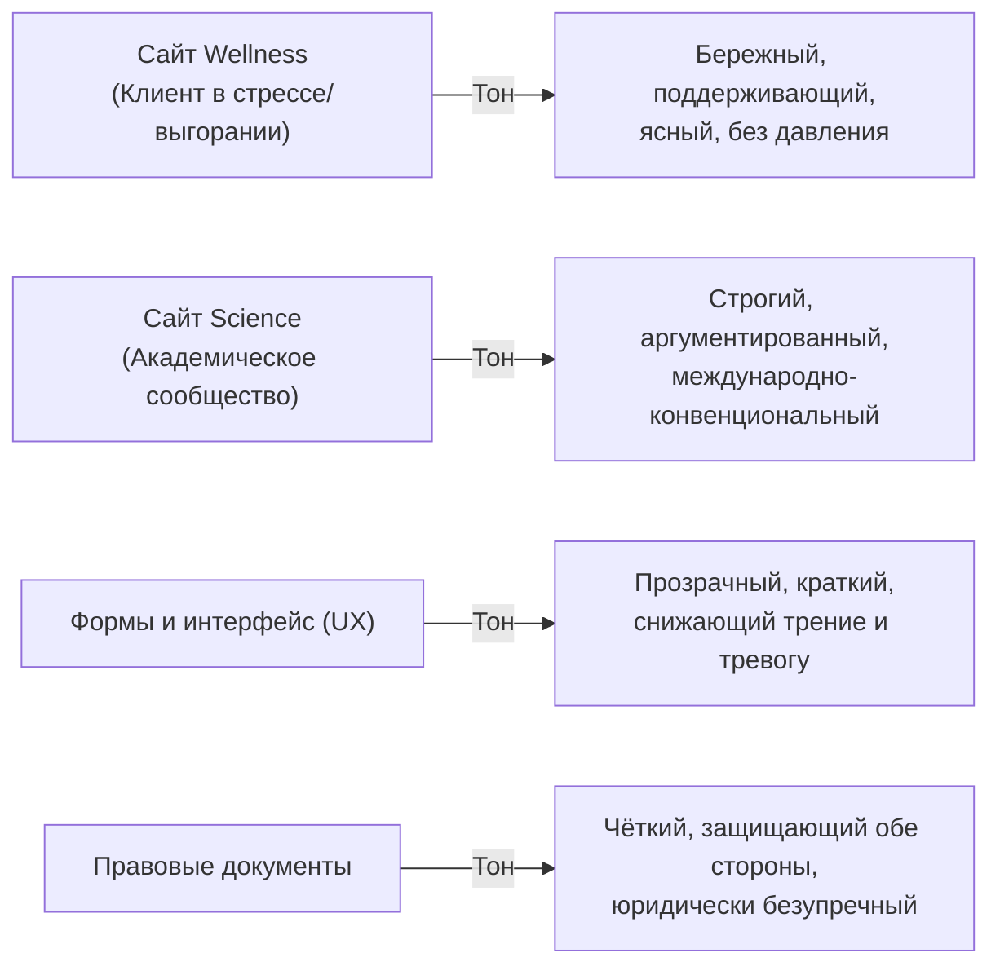

# Tone of Voice Guide (Голос и тональность бренда Наталии Долговой)

**Статус:** Канонический стандарт проекта  
**Дата утверждения:** 31 октября 2026 г.  
**Область действия:** Сайты `apps/wellness` и `apps/science`, публикации, социальные сети (Telegram, B17, VK, LinkedIn), рассылки и коммуникация с клиентами.

---

## 1. Личность бренда и ключевой архетип

Бренд Наталии Долговой объединяет два начала:
1. **Глубокий исследователь (Dr. phil., к.э.н., 15+ лет в образовании):** системность, опора на эмпирические данные, точность формулировок, академическая этика.
2. **Эмпатичный практик (психолог МПГУ, тренер по нейроинтеграции, инструктор цигун):** бережность, уважение к темпу человека, отсутствие давления, партнерская позиция.

**Ключевой архетип:** *Мудрец + Заботливый (The Sage & The Caregiver)*.  
Мы не поучаем и не спасаем — мы исследуем, даем надежные ориентиры и помогаем человеку восстановить контакт с собственными ресурсами.

---

## 2. Основные измерения тональности (Voice Dimensions)

| Параметр | Как мы звучим | Как мы НЕ звучим |
| :--- | :--- | :--- |
| **Лицо автора** | **Первое лицо («Я», «в моей практике», «мы исследуем»):** живой контакт эксперта с читателем. | Отчуждённое третье лицо («Наталия принимает клиентов», «автор проекта предлагает»). |
| **Отношение к клиенту** | **Взрослый со Взрослым:** равноправный диалог двух дееспособных людей. Уважение к автономии выбора. | Родительская опека, сюсюканье, менторство или запугивание последствиями. |
| **Доказательность** | **Evidence-based:** опора на нейробиологию, физиологию дыхания, КПТ, ACT. Понятные причинно-следственные связи. | Эзотерика, туманная магия («потоки», «вибрации», «исцеление кармы», «тотальная трансформация»). |
| **Обещания** | **Реалистичные и конкретные:** «освоение навыков саморегуляции», «снижение фоновой тревоги», «план действий». | Ложные абсолютные гарантии («100% результат за одну сессию», «избавлю от выгорания навсегда»). |
| **Эмоциональный фон** | **Спокойная уверенность, ясность, заземленность.** Текст снижает тревогу уже в процессе чтения. | Истеричный маркетинговый пафос, капслок, давление дедлайнами («Только сегодня! Спешите!»). |

---

## 3. Матрица ситуаций (Tone by Context)

Тональность адаптируется в зависимости от платформы и эмоционального состояния читателя:

### 3.1. Wellness (Частная практика)
- **Контекст:** Читатель часто находится в состоянии когнитивной перегрузки, усталости, тревоги или профессионального выгорания.
- **Задача:** Снизить порог входа, дать надежду на понятные изменения, убрать страх оценки.
- **Принцип текста:** Короткие абзацы, ясная триада **«Мозг — Психика — Тело»**, прозрачные цены без скрытых условий.

### 3.2. Science (Академический профиль)
- **Контекст:** Читатели — профессора, исследователи, редакторы журналов Scopus/WoS, руководители университетов и колледжей.
- **Задача:** Продемонстрировать научную компетентность, методологическую строгость и международный вес (Dr. phil. magna cum laude).
- **Принцип текста:** Общепринятая научная терминология (*perceived effectiveness*, *mixed-methods triangulation*, *TVET engineering educators*), ссылки на DOI, реестры Scopus, ORCID и eLibrary. Полный отказ от бытовой разговорной лексики.

---

## 4. Запрещённые слова и предпочтительные синонимы

| Категорически запрещено | Рекомендуется использовать | Почему |
| :--- | :--- | :--- |
| *«В гармонии с собой»*, *«найти свой дзен»* | *«Без выгорания и самонасилия»*, *«устойчивый ритм жизни»* | Устраняет эзотерический налёт, возвращает в практическое русло. |
| *«Первая встреча»*, *«установочная сессия»* | *«Консультация»* | Унифицированный термин (DEC-036). Клиент точно знает формат услуги. |
| *«Психотерапия»*, *«лечение»*, *«исцеление»* | *«Психологическое консультирование»*, *«практики саморегуляции»* | Услуги носят немедицинский характер (152-ФЗ, закон о защите прав потребителей). |
| *«Боль»*, *«страдание»*, *«недуг»* | *«Запрос»*, *«сложная ситуация»*, *«перегрузка»* | Избегает манипулятивного маркетингового давления на уязвимость. |
| *«Мой первый продукт»* | *«Базовый формат воркшопа»*, *«программа для команд»* | Сохраняет солидный статус эксперта с 15-летним стажем. |
| *«Feel effective»* (в англ. версии) | *«Perceived effectiveness»* | Канонический термин диссертации и публикаций в Scopus. |
| *«Пока форма настраивается...»* | *«Вы можете записаться напрямую в Telegram...»* | Устраняет ощущение незавершённости или поломки сайта. |

---

## 5. Примеры «Плохо → Хорошо»

### Пример 1. Описание первого шага
- **Плохо:** «Оставьте заявку на первую платную встречу, чтобы Наталия оценила ваш случай и подтвердила, готова ли она взять вас в работу».
- **Хорошо:** «Запишитесь на консультацию. На первой встрече мы подробно разберём вашу ситуацию, снизим острое напряжение и наметим понятный план действий».

### Пример 2. Описание метода нейроинтеграции
- **Плохо:** «Уникальная методика НейроБаланса и НейроСёрфинга прокачает ваш мозг и выведет продуктивность на космический уровень».
- **Хорошо:** «Нейроинтеграция — прикладная система саморегуляции на основе нейробиологии. Она помогает управлять ресурсом нервной системы, справляться с прокрастинацией и двигаться к целям короткими шагами без насилия над собой».

### Пример 3. Описание B2B-предложения
- **Плохо:** «Мы предлагаем инновационные вебинары по стресс-менеджменту, отвечающие потребностям каждой современной IT-компании».
- **Хорошо:** «Интерактивные воркшопы и программы профилактики выгорания для команд. Помогаем сотрудникам освоить физиологические микропрактики восстановления прямо в рабочем графике».
